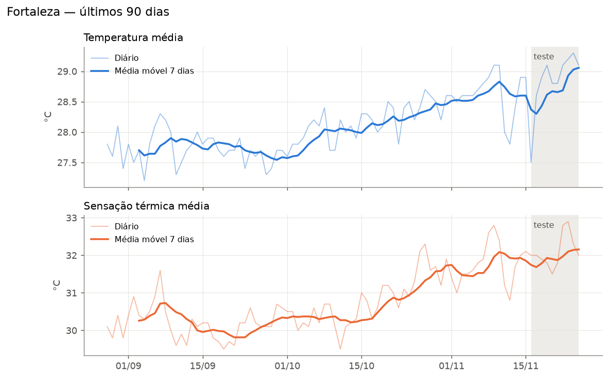
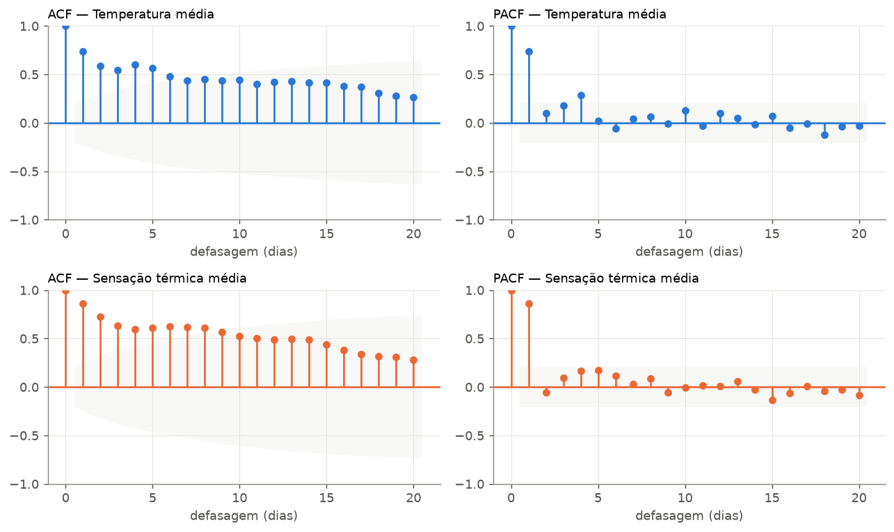
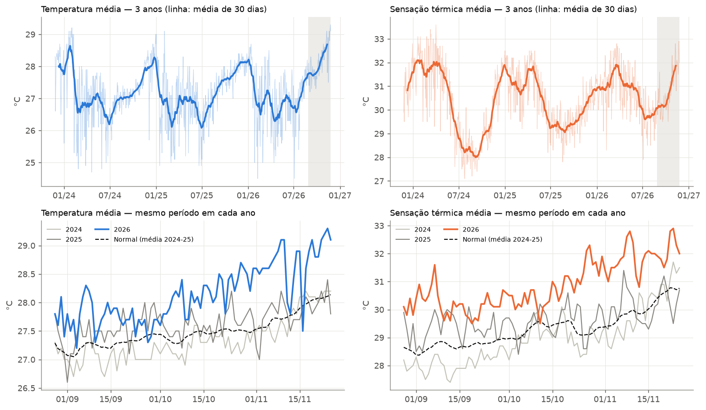
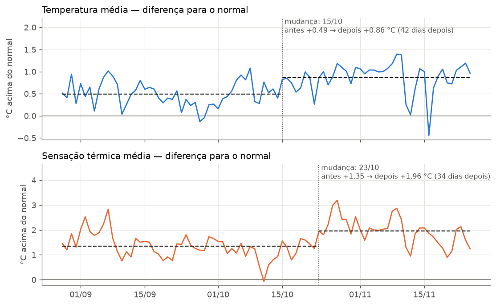

# Diário do projeto

Registro de cada etapa: o que foi feito, os resultados e o que aprendi.

---

## Etapa 0 — Preparação (2026-11-26)

### O que foi feito
- Plano aprovado: monorepo com `/backend`, `/frontend` e `/docs`, 9 etapas (0 a 8).
- Escopo ampliado: além da temperatura média, vamos prever a **sensação térmica média**
  (decisão D02, opção a).
- Python 3.12.10 instalado com `py install 3.12` (o 3.15 do sistema continua lá — decisão D11).
- Repositório Git criado (branch `main`) e `.gitignore` (ignora `.venv`, caches, `node_modules`).
- Ambiente virtual `backend/.venv` com as bibliotecas fixadas em `requirements.txt`:
  pandas 3.1.1, numpy 2.5.5, requests 2.34.2, matplotlib 3.11.2, statsmodels 0.15.0,
  prophet 1.5.0, Flask 3.1.3, flask-cors 6.0.5, pytest 9.2.0, ruff 0.17.6.
- `pyproject.toml` configurando ruff e pytest.
- Teste de ambiente (`tests/test_ambiente.py`): importa as bibliotecas e treina um Prophet com
  30 dias fictícios.
- Documentação inicial: `CLAUDE.md`, `README.md` e os arquivos de `docs/`.

### Resultados
- `ruff check`: sem erros (após um ajuste — ver abaixo).
- `pytest`: **2 testes passaram**. Avisos vindos de dentro do Prophet (uso de recurso do pandas
  que será descontinuado) — não afetam o funcionamento.

### O que aprendi
- **Ambiente virtual** isola as bibliotecas de cada projeto; versões fixadas no
  `requirements.txt` tornam o ambiente reproduzível.
- **Versão nova nem sempre é melhor:** o Python 3.15 é recente demais para o ecossistema
  científico; o 3.12 é a escolha segura.
- **Teste de fumaça:** um teste simples que "liga o motor" (treinar um Prophet minúsculo) detecta
  problemas de instalação antes de começarmos o trabalho de verdade.
- **Linter na prática:** o ruff apontou uma linha com 106 caracteres (limite 100); o
  `ruff format` corrigiu automaticamente.

### Dúvidas discutidas após a etapa
- **"A sensação térmica é só apoio da temperatura?"** Não: ela é prevista sozinha, com os mesmos
  modelos e métricas (D02 reescrita para deixar isso claro). A "variável auxiliar" era a opção
  descartada.
- **"Adicionar umidade e vento deixaria a sensação mais precisa?"** Em teoria, sim, mas para
  prever o futuro precisaríamos também da umidade e do vento futuros, que ainda não aconteceram.
  Prevê-los soma erros; usar a previsão pronta do Open-Meteo esvazia a POC. Decidimos manter o
  escopo (D19).
- **Lição:** uma variável que ajuda a *explicar* o passado nem sempre ajuda a *prever* o futuro.
  Ela só ajuda se o valor futuro dela for conhecido ou fácil de prever.

---

## Etapa 1 — Coleta de dados (2026-11-26)

### O que foi feito
- `backend/previsao/coleta.py`: funções pequenas e separadas — calcular o período, baixar as
  duas APIs, converter JSON em tabela, juntar as fontes (histórico tem prioridade), verificar a
  tabela (dias faltando, duplicados, vazios) e comparar as fontes nos dias em comum.
- `backend/scripts/etapa1_coleta.py`: roda a coleta real, salva o CSV e imprime um resumo.
- `backend/tests/test_coleta.py`: 8 testes com respostas falsas (sem internet — D22).
- Dados salvos em `backend/data/fortaleza_diario.csv`.

### Resultados
- **Período:** 28/08/2026 a 25/11/2026 — **90 dias, todos da API histórica** (`best_match`),
  sem dias faltando nem valores vazios.

| °C | Temperatura média | Sensação média |
|---|---|---|
| Média | 28,15 | 30,87 |
| Desvio-padrão | 0,52 | 0,88 |
| Mínimo | 27,2 | 29,5 |
| Máximo | 29,3 | 32,9 |
| Últimos 3 dias | 29,2 / 29,3 / 29,1 | 32,9 / 32,3 / 32,0 |

- **Comparação de fontes** (feita para investigar a diferença 0,0 °C entre histórico e previsão):

| Fonte | Último dia | Temp. média | Sensação média |
|---|---|---|---|
| `best_match` | 25/11 | 28,09 | 30,78 |
| `era5` puro | 19/11 | 27,50 | 29,87 |

- `pytest`: 10 testes passaram. `ruff`: sem erros.

### O que aprendi
- **Desconfie de resultado perfeito demais.** A diferença 0,0 °C entre as fontes parecia ótima,
  mas indicava que as duas APIs eram, na verdade, a mesma fonte. Investigar revelou que a ERA5
  pura é ~0,6 °C mais fria em Fortaleza.
- **Emendar fontes diferentes pode fabricar uma quebra estrutural.** O plano original (ERA5 +
  previsão nos últimos dias) criaria um salto artificial exatamente no período que queremos
  estudar. Consistência da fonte importa mais que "a fonte mais nobre" (D21).
- **Fortaleza varia pouco:** desvio-padrão de 0,5 °C na temperatura. As "mudanças fortes" serão
  de ~1–2 °C — pequenas em valor absoluto, mas grandes perto da variação normal. A sensação varia
  ~70% mais que a temperatura (0,88 x 0,52), como esperávamos (umidade e vento).
- **Os últimos dias estão no topo da série** (29,1–29,3 °C, perto do máximo de 29,3): primeiro
  indício da mudança recente, a ser analisada na etapa 2.
- **Hoje não entra na série** (D20): a média de um dia incompleto é parte previsão.

### Dúvidas discutidas antes da etapa 2
- **ERA5, `best_match` e `past_days`:** são duas APIs (histórica e de previsão). `models` escolhe
  o modelo meteorológico (`era5` ou `best_match`); `past_days` pede dias passados à API de
  previsão. Explicação completa no glossário.
- **A pouca variação atrapalha?** O que importa é ter padrão, não variar muito — e a série tem
  memória (autocorrelação 0,75/0,87). Mantivemos os 90 dias (D23).
- **6 meses ou 1 ano ajudariam?** Baixamos 3 anos só para olhar: Fortaleza tem um ciclo anual de
  ~2 °C. Mais meses misturariam estações; só com 2+ anos dá para modelar o ciclo. Decidimos usar
  os 3 anos apenas como **contexto** (D24).

---

## Etapa 2 — Exploração (2026-11-26)

### O que foi feito
- `backend/previsao/exploracao.py`: média móvel, teste ADF, força da sazonalidade semanal,
  detecção de ponto de mudança, contexto de 3 anos (mesmo período por ano, climatologia, anomalia).
- `backend/scripts/etapa2_exploracao.py`: números no terminal e 4 gráficos em `docs/img/`.
- `backend/tests/test_exploracao.py`: 5 testes com séries sintéticas de comportamento conhecido.
- `backend/data/fortaleza_contexto_3anos.csv`: 1.096 dias (26/11/2023 a 25/11/2026).

### Resultados

**Série de 90 dias**

| | Temperatura | Sensação |
|---|---|---|
| Autocorrelação 1 / 2 / 3 / 7 dias | 0,75 / 0,63 / 0,60 / 0,54 | 0,87 / 0,75 / 0,68 / 0,72 |
| ADF na série (p-valor) | 0,86 → **não estacionária** | 0,92 → **não estacionária** |
| ADF nas diferenças diárias (p-valor) | 0,00 → estacionária | 0,00 → estacionária |
| Força da sazonalidade semanal | 0,10 (fraca) | 0,12 (fraca) |

- **ACF** cai devagar (típico de série com tendência). **PACF** tem um pico forte só na
  defasagem 1 (0,74 e 0,86) e o resto fica dentro da faixa de significância (temperatura tem
  pequenos picos em 3–4 dias, no limite).

**Contexto de 3 anos**

| Mesmo período (28/08–25/11) | Temp. média | Sensação média |
|---|---|---|
| 2024 | 27,34 | 28,96 |
| 2025 | 27,63 | 29,63 |
| **2026** | **28,15** | **30,87** |

| Subida dentro do período (últimos 15 dias − primeiros 15) | Temp. | Sensação |
|---|---|---|
| 2024 | +0,95 | +2,67 |
| 2025 | +0,55 | +0,75 |
| 2026 | +0,94 | +1,58 |

**Anomalia de 2026 e ponto de mudança**

| | Temperatura | Sensação |
|---|---|---|
| Anomalia média no período | +0,66 °C | +1,58 °C |
| Anomalia nos últimos 10 dias | +0,79 °C | +1,54 °C |
| Mudança detectada (na anomalia) | **15/10**: +0,49 → +0,86 | **23/10**: +1,35 → +1,96 |
| Mudança detectada (na série bruta) | 23/10: 27,85 → 28,65 | 25/10: 30,33 → 31,86 |

- `pytest`: 15 testes passaram. `ruff`: sem erros.

### O que aprendi
- **A subida recente é metade estação, metade anomalia.** Todo ano a temperatura sobe ~0,5–1 °C
  de agosto a novembro — isso é estação. O que é diferente em 2026 é o **nível**: o ano inteiro
  está acima do normal (+0,5 °C já em setembro), e a partir de meados de outubro sobe mais um
  degrau (+0,86 °C). Na sensação o efeito é maior (+1,96 °C após 23/10).
- **Onde se procura a mudança muda a resposta:** na série bruta o detector aponta 23–25/10, porque
  mistura estação e anomalia; na anomalia aponta 15/10 (temperatura). Para o caso de estudo, a
  data candidata é **meados/fim de outubro** — a escolha exata fica para a etapa 5.
- **Pistas para a modelagem (etapa 3):**
  - Série **não estacionária**, diferenças estacionárias → o SARIMA deve usar **d = 1**.
  - PACF com um pico só na defasagem 1 → um termo autorregressivo (p = 1) deve bastar; com d = 1,
    candidatos simples como ARIMA(1,1,0) ou (0,1,1).
  - **Sem padrão semanal** (força ~0,1) → nem SARIMA nem ETS precisam de sazonalidade de 7 dias;
    o "S" do SARIMA provavelmente ficará desligado. Prophet com sazonalidade semanal só
    acrescentaria ruído.
  - Há **tendência de alta** no fim da série — mas parte é estação, que vai se estabilizar em
    dezembro (pico do ciclo). Um modelo que prolongue a tendência pode exagerar.
- **Um dia atípico no início do teste:** 16/11 teve 27,5 °C (−0,4 °C abaixo do normal, provável
  dia de chuva), seguido de volta rápida a 28,6–29,3. Ele vai pesar nas métricas da etapa 4.
- **Testes estatísticos erram.** O teste do ADF falhou com uma semente aleatória "azarada" (p =
  0,013 num passeio aleatório): é o erro de ~5% que o próprio teste admite.
