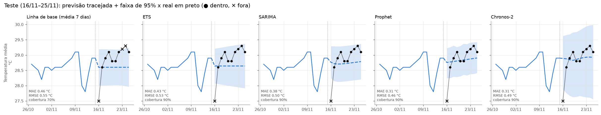

# Relatório final — POC de previsão de temperatura em Fortaleza

> **Retrato de 26-11-2026.** Os números deste relatório usam os 90 dias de 28-08-2026 a
> 25-11-2026. A ferramenta atualiza os dados e retreina os modelos sozinha todo dia (D44), então a
> tela mostra sempre números atuais, que podem diferir dos daqui.
>
> **Atualização (evolução 11.2, 26-11-2026):** o **Chronos-2**, um modelo de IA moderna, entrou
> como 5º modelo, com os mesmos dados e o mesmo teste (D47). Os resultados dele estão nas seções
> 4 a 9 e o resumo da evolução está na 11.2.
>
> **Simplificação (27-11-2026, D52):** a POC passou a prever **só a temperatura média**. A
> sensação térmica, que era uma segunda série, foi retirada: dobrava telas, tabelas e números sem
> trazer uma lição nova. Sem ela, a recomendação mudou de SARIMA para **Chronos-2** (seção 7).
>
> Os códigos entre parênteses (D07, D33...) apontam para as decisões detalhadas em
> [`decisoes.md`](decisoes.md). Este relatório se explica sozinho: não é preciso abrir outros
> arquivos para entendê-lo.

---

## Em poucas palavras

**O que fizemos.** Construímos uma ferramenta que olha os últimos 90 dias de temperatura de
Fortaleza e tenta adivinhar a próxima semana. Ela não dá só um número: dá
também uma **faixa** onde o valor real deve cair ("29,2 °C, provavelmente entre 28,1 e 29,6").
Comparamos cinco formas de prever — de uma regra simples ("repetir a média da última semana") até
uma IA moderna da Amazon — e, para saber qual funciona, escondemos os últimos 10 dias, pedimos a
previsão e conferimos com o que aconteceu de verdade.

**O que descobrimos.**
1. **Dá para prever melhor que a regra simples, mas o ganho é modesto.** Os melhores modelos
   erraram em média 0,3 °C por dia — até um terço menos que a regra simples. Fortaleza varia
   pouco, então todos erram pouco.
2. **O recomendado é o Chronos-2, a IA moderna.** Sem aprender nada com os nossos dados, ele
   empatou com o melhor modelo no teste e foi o melhor sozinho quando repetimos o teste um dia
   depois. O ponto fraco: a faixa dele é quase duas vezes mais larga, ou seja, diz menos.
3. **Os vencedores mudam de um teste para outro.** As diferenças entre os modelos são de décimos
   de grau; com só 10 dias de teste, parte disso é sorte. Antes de fixar um modelo em produção, o
   teste deve ser repetido em várias semanas.
4. **Um modelo só conhece o passado que viu.** Quando o clima mudou de patamar em outubro, os
   modelos que não viram a mudança erraram de 2 a 3 vezes mais — e com falsa confiança. Por isso
   a ferramenta atualiza os dados e refaz os modelos sozinha, todo dia.
5. **Para o tempo em si, a meteorologia ganha.** Sites como o do Google simulam a atmosfera
   inteira; nossos modelos só olham o histórico. O valor deste trabalho está no **método**, que
   serve para números do negócio (vendas, demanda), onde não existe uma "simulação da atmosfera"
   para consultar.

---

## 1. Resumo executivo

- **O que foi feito:** uma ferramenta web que baixa os últimos 90 dias de temperatura média de
  Fortaleza, roda cinco modelos de previsão, prevê os próximos 7 dias com uma faixa de incerteza e
  mostra tudo em gráficos e textos simples.
- **Quanto erra:** testados em 10 dias que não conheciam, os melhores modelos erraram em média
  **~0,3 °C** por dia — um terço menos que a regra simples "repetir a média da semana" (0,46 °C).
- **Modelo recomendado: Chronos-2** (D52). Uma rede neural da Amazon, já treinada com milhões de
  séries, que **empatou com o melhor** no teste (0,31 °C, junto com o Prophet) sem nenhum ajuste.
  Repetindo o teste um dia depois, foi o **melhor sozinho** (0,38 °C), enquanto o SARIMA ficou pior
  que a regra simples. O ponto fraco: a faixa de incerteza é **quase duas vezes mais larga**.
  Ranking completo na seção 7.
- **Principal lição:** um modelo só conhece o passado que viu. Quando o clima muda de patamar
  (como em meados de outubro de 2026), um modelo desatualizado erra de 2 a 3 vezes mais — e,
  quando a faixa é estreita, com falsa confiança. A ferramenta já se protege disso atualizando os
  dados e refazendo os modelos todo dia.

---

## 2. Objetivo

Provar, de ponta a ponta, o ciclo de uma previsão de série temporal pequena:

**dados → modelos → validação → previsão → tela**

Uma **série temporal** é uma sequência de valores medidos ao longo do tempo, em intervalos
regulares — aqui, um valor por dia. "Prever" é estimar os próximos valores a partir do
comportamento dos anteriores.

A pergunta central da POC: **com só 90 dias de histórico, dá para prever a próxima semana melhor
do que uma regra simples?** Resposta curta: sim, com ganho moderado (seção 6).

---

## 3. Dados

| Item | Valor |
|---|---|
| Local | Fortaleza-CE (lat −3,72, lon −38,54), fuso `America/Fortaleza` |
| Variável | Temperatura média diária |
| Período | 90 dias terminando **ontem** (hoje ainda está incompleto) — no retrato: 28-08-2026 a 25-11-2026 |
| Fonte | Open-Meteo, API histórica (`best_match`), gratuita e sem cadastro |
| Atualização | Automática: ao primeiro acesso do dia, a ferramenta baixa os dados novos e retreina |

**Como a série se comporta (90 dias):**

| °C | Temperatura |
|---|---|
| Média | 28,15 |
| Variação típica (desvio-padrão) | 0,52 |
| Mínimo / máximo | 27,2 / 29,3 |

- **Fortaleza varia pouco:** a temperatura oscila tipicamente ±0,5 °C em torno da média. Por isso
  os erros dos modelos são pequenos em °C — e as diferenças entre eles também.
- **A série tem "memória":** o valor de hoje se parece muito com o de ontem (correlação de
  0,75). É isso que torna a previsão possível.
- **Não há padrão semanal:** o clima não sabe que dia da semana é. Os modelos foram configurados
  sem ciclo de 7 dias.
- **2026 está mais quente que o normal:** detalhes logo abaixo.

### Comparação com os anos anteriores

Para saber se a alta recente é "normal para a época" ou algo diferente, comparamos os nossos 90
dias com **o mesmo período do calendário (28/08 a 25/11) em 2024 e 2025**. Os dados vão até
25-11-2026 e começam em 26-11-2023, então há **2 anos anteriores completos** para comparar.

- **Normal:** a média de 2024 e 2025 no mesmo dia do calendário (suavizada em 7 dias, porque a
  média de só 2 anos ainda oscila muito).
- **Anomalia:** quanto 2026 ficou acima (+) ou abaixo (−) do normal no mesmo dia.
- **Subida no período:** a média dos últimos 15 dias menos a dos primeiros 15. Se todo ano sobe,
  é a **estação do ano** (de agosto a novembro Fortaleza esquenta).

| Mesmo período (28/08–25/11) | Temp. média | Subida no período |
|---|---|---|
| 2024 | 27,34 °C | +0,95 °C |
| 2025 | 27,63 °C | +0,55 °C |
| **2026** | **28,15 °C** | **+0,94 °C** |

| Anomalia de 2026 | Temperatura |
|---|---|
| No período (média) | +0,66 °C |
| Nos últimos 10 dias | +0,79 °C |
| Degrau (mudança de patamar) | **15-10-2026**: +0,49 → +0,86 °C |

**O que isso mostra:**
1. **Parte da alta é estação:** todo ano a temperatura sobe nesse período — em 2024 e 2025
   também.
2. **Parte é anomalia:** 2026 inteiro está acima do normal (+0,66 °C), e a partir de meados de
   outubro a diferença subiu mais um degrau.
3. **O degrau é a base do caso de estudo (seção 8):** a data 15-10 foi encontrada
   automaticamente na anomalia, testando cada data de corte e escolhendo a que melhor divide a
   série em dois trechos com médias diferentes (D26).

*Os dados dos anos anteriores servem só para **entender** a série; os modelos continuam usando só
os últimos 90 dias (D24). Na ferramenta web, esta comparação está na aba **"Anos anteriores"** do
card **"Visão geral dos modelos"**, recalculada todo dia.*

---

## 4. Gráficos da previsão

Previsão dos 7 dias seguintes (26-11-2026 a 02-12-2026) pelos cinco modelos, a partir dos 90
dias. A linha contínua é o histórico real; as tracejadas são as previsões; a área sombreada é a
**faixa de 95%** (explicada na seção 5.1).

| Previsão (°C) | 26-11 | 02-12 |
|---|---|---|
| Linha de base | 29,06 | 29,06 |
| ETS | 29,07 | 29,07 |
| SARIMA | 29,09 | 29,26 |
| Prophet | 28,99 | 29,11 |
| Chronos-2 | 29,16 | 29,26 |

Último valor real (25-11-2026): 29,1 °C.

Os modelos se dividem em dois grupos: **linha de base e ETS** preveem estabilidade; **SARIMA,
Prophet e Chronos-2** prolongam a alta recente (≈ +0,1 a +0,2 °C na semana).

Na ferramenta web, o mesmo gráfico aparece para o modelo escolhido, com cartões de destaque
("Amanhã: 29,1 °C, entre 28,5 e 29,7") e um resumo em texto simples gerado com os números reais.

---

## 5. Como cada modelo foi decidido e configurado

Esta seção explica cada modelo do zero. Antes, quatro ideias que valem para todos.

### 5.1 Conceitos comuns

- **Treinar um modelo:** ajustar alguns números internos (os **parâmetros**) para que o modelo
  descreva bem o histórico. Ex.: "quanto o dia de ontem pesa na previsão de hoje".
- **Horizonte:** quantos dias à frente se prevê. Aqui, 7 dias (a ferramenta aceita de 1 a 14).
- **Faixa (intervalo) de 95%:** em vez de um número só, o modelo dá uma faixa onde o valor real
  deve cair em 95 de cada 100 previsões. Ex.: "29,1 °C, provavelmente entre 28,5 e 29,7 °C". Faixa
  estreita = modelo confiante. Quanto mais longe o dia previsto, mais larga a faixa.
- **Escolha automática da configuração:** ETS e SARIMA têm várias versões possíveis (com ou sem
  tendência etc.). Em vez de escolher à mão, a ferramenta treina todas as versões candidatas e
  fica com a de **menor AICc**, refazendo essa escolha a cada treino (D28).
  - **AICc** é uma "nota" para comparar versões de um modelo: soma o erro no histórico com uma
    **multa por complexidade** (cada parâmetro a mais custa pontos). Menor = melhor. Serve para
    não escolher um modelo que "decora" o histórico em vez de aprender o padrão. O "c" é uma
    correção para séries curtas como a nossa. Diferenças menores que 2 pontos são consideradas
    empate.
  - Ex.: versão A erra um pouco menos que a versão B, mas usa 3 parâmetros a mais. A multa pode
    fazer a B ganhar — a explicação mais simples que funciona é preferida.

### 5.2 Linha de base — a régua

- **O que é:** uma regra fixa, não um modelo estatístico: **a previsão para cada um dos próximos
  dias é a média dos últimos 7 dias.** Ex.: se a última semana teve média de 29,06 °C, a previsão
  é 29,06 °C para todos os 7 dias (uma reta horizontal).
- **Por que existe:** é a régua. Um modelo só vale a pena se errar menos que ela (D07).
- **Faixa de 95% (D29):** a regra não tem fórmula de incerteza, então a calculamos pelo próprio
  passado: aplicamos a regra em todos os dias do histórico, medimos quanto ela errou 1, 2, ... 7
  dias depois e usamos esse tamanho de erro como faixa. É honesto (mostra o quanto a própria
  regra costuma errar) e a faixa cresce com a distância.
- **Configuração:** fixa — não há nada a escolher.

### 5.3 ETS (suavização exponencial)

- **O que é:** uma média ponderada do passado em que **os dias recentes pesam mais** e o peso cai
  aos poucos para os dias antigos. É um modelo clássico dos anos 1950–60. "ETS" vem de *Error,
  Trend, Seasonality* (erro, tendência, sazonalidade) — as três peças que ele pode ter.
- **O parâmetro principal, α (alfa):** um número entre 0 e 1 que diz quanto o modelo confia no
  último dia.
  - α perto de 1: "amanhã ≈ hoje" — reage rápido, mas é nervoso.
  - α perto de 0: "amanhã ≈ média de muitos dias" — estável, mas lento para perceber mudanças.
  - Ex.: com α = 0,3, o último dia pesa 30%, o anterior 21% (30% de 70%), o seguinte 15% e assim
    por diante.
- **Candidatos testados (D30):** sem tendência; com tendência (a previsão sobe ou desce em linha
  reta); com **tendência amortecida** (sobe ou desce, mas cada vez menos, até estabilizar).
  Nenhum com sazonalidade, porque não há ciclo semanal.
- **Escolhido pelo AICc:**

| | Temperatura |
|---|---|
| Versão | sem tendência |
| α | **0,29** — média de vários dias |

- **O que isso significa:** o ETS prevê uma reta horizontal (estabilidade), parecida com a regra
  simples, mas dando mais peso aos dias recentes.
- **Ferramenta:** `ETSModel` da biblioteca statsmodels, que calcula a faixa de incerteza.

### 5.4 SARIMA

- **O que é:** o modelo clássico de séries temporais (método Box-Jenkins, anos 1970). O nome junta
  as peças que ele pode ter: **S**azonal + **AR** + **I** + **MA**. A configuração é escrita como
  SARIMA(p, d, q) — três números, explicados abaixo.
- **AR — autorregressivo (p):** a previsão usa os valores dos **p dias anteriores**. Ex.: com
  p = 1, "amanhã = uma fração de hoje + um ajuste". É a "memória" da série.
- **I — integrado (d):** quantas vezes a série é transformada em **variações diárias** antes de
  modelar. Com d = 0, o modelo olha os valores (29,1; 29,3; 29,2...). Com d = 1, olha as
  variações (+0,2; −0,1...). Usa-se d = 1 quando a série "passeia" sem voltar a um nível ou a uma
  reta.
- **MA — média móvel (q):** a previsão é corrigida pelo **erro dos q dias anteriores**. Ex.: com
  q = 1, se o modelo errou para baixo ontem, ele ajusta a previsão de hoje para cima.
- **Sazonal (S):** a repetição das peças acima em ciclos (ex.: a cada 7 dias). Entrou como
  candidata e **perdeu** — confirmou que não há ciclo semanal.
- **Tendência / drift:** uma inclinação constante somada à previsão. Com d = 0 chama-se
  **tendência linear** (a série oscila em torno de uma reta inclinada); com d = 1 chama-se
  **drift** (as variações diárias têm uma média diferente de zero, ex.: +0,03 °C por dia).
- **Como d é escolhido (D33):** por um teste estatístico, o **ADF** (Dickey-Fuller aumentado), que
  pergunta "a série volta sempre para uma reta?". Se a resposta for "sim" com segurança (p-valor
  menor que 0,05 — menos de 5% de chance de o teste estar enganado), usa-se d = 0 com tendência;
  senão, d = 1. Em seguida, o AICc escolhe p, q, a parte sazonal e a tendência entre **72
  combinações** (p e q de 0 a 2, com e sem parte sazonal, com e sem tendência — D31).
- **Escolhido (treino com os 90 dias):**

| | Temperatura |
|---|---|
| Teste ADF | p = 0,17 → inconclusivo → d = 1 |
| Configuração | **SARIMA(1, 1, 1) + drift** |
| Em palavras | variações diárias com memória de 1 dia, correção pelo erro de ontem e leve alta |
| Melhor versão *com* ciclo semanal | 3º lugar |

- **Observação importante:** no treino da validação (só 80 dias), a temperatura passou no teste
  ADF e ficou com SARIMA(1, 0, 0) + tendência linear. **Com séries curtas, a configuração
  escolhida muda com poucos dias a mais ou a menos** — por isso a ferramenta refaz a escolha a
  cada treino, em vez de fixá-la.
- **O que isso significa:** o SARIMA parte do último valor real (memória de curto prazo) e
  prolonga a alta recente (+0,03 °C por dia), com a faixa mais estreita entre os modelos com
  memória.
- **Ferramenta:** `SARIMAX` da statsmodels, com busca própria das combinações.

### 5.5 Prophet

- **O que é:** um modelo da Meta (2017) que desenha a série como uma **soma de curvas**: uma
  tendência + ciclos (anual, semanal) + feriados. Foi feito para séries **longas** de negócio
  (anos de dados diários, com sazonalidades fortes). Entrou na POC **só como comparação**, para
  mostrar o que acontece quando a ferramenta não combina com o problema (D07).
- **Tendência por partes:** a tendência é uma linha que pode **mudar de inclinação** em alguns
  pontos (os "pontos de mudança"), que o próprio Prophet escolhe.
- **Configuração (D32):** todas as sazonalidades **desligadas** —
  90 dias não contêm um ano inteiro (a sazonalidade anual seria inventada) e não há ciclo
  semanal. Sobra só a tendência por partes. Faixa de 95%; semente aleatória fixa para que a faixa
  (calculada por simulação) saia igual a cada execução.
- **Característica decisiva:** o Prophet **não tem memória de curto prazo** — ele desenha a linha
  de tendência sem olhar o último valor. Por isso começa a previsão em 28,99 °C, abaixo do último
  real (29,1 °C). Isso o ajuda quando a tendência continua e o atrapalha quando ela para.

### 5.6 Chronos-2 — IA moderna (evolução 11.2)

- **O que é:** uma **rede neural** da Amazon (2025). Rede neural é um programa com milhões de
  números internos ajustados para reconhecer padrões; o Chronos-2 tem cerca de 120 milhões. Ele é
  um **modelo fundacional**: já vem treinado pela Amazon com **milhões de séries de todo tipo**
  (vendas, energia, clima, tráfego) e aprendeu como séries costumam se comportar.
- **Diferença para os outros quatro:** ele **não é treinado com os nossos dados**. Recebe os 90
  valores como **contexto** (só os números — nem sabe que é temperatura) e projeta os próximos
  dias com o que já aprendeu. Na prática isso se chama **zero-shot**: prever uma série que o
  modelo nunca viu, sem nenhum ajuste. Não há configuração para escolher (nada de AICc).
- **Como sai a faixa de 95%:** o Chronos-2 não devolve uma média e uma faixa, e sim **quantis**.
  Um quantil é um valor de corte: o quantil de 2,5% é o valor com só 2,5% de chance de o real
  ficar abaixo dele. A previsão é o quantil de 50% (a **mediana**, o valor do meio), e a faixa vai
  do quantil de 2,5% ao de 97,5%. O modelo foi treinado para dar quantis de 1%, 5%, 10%... 95% e
  99%; os de 2,5% e 97,5% a biblioteca calcula entre os vizinhos (D47).
- **Configuração (D47):** versão **Chronos-2** (a mais nova; as menores, "Bolt", só dão faixas de
  até 80%, então não seriam comparáveis), rodando no processador comum (CPU), sem placa de vídeo.
  O modelo (456 MB) é baixado uma vez do Hugging Face (um repositório público de modelos); depois
  funciona **sem internet e sem espera**: a ferramenta carrega o modelo direto da cópia guardada
  no computador. A **versão do modelo é fixa** (um código de versão no nosso programa), para que
  uma atualização publicada pela Amazon não mude os números sem aviso (D51). Os dados **não saem
  do computador**. Licença Apache 2.0: gratuito, com
  uso comercial permitido.
- **Características:** é rápido (0,06 s por previsão, contra ~17 s do SARIMA, que testa 72
  combinações) e dá sempre o mesmo resultado para a mesma série. Sua faixa é **assimétrica**
  (mais espaço abaixo da mediana do que acima) e **larga**: ele aprendeu com séries muito mais
  agitadas que a de Fortaleza e não estreita a faixa para a nossa série calma.

---

## 6. Comparação dos modelos

**Como testamos:** escondemos os últimos 10 dias (16-11-2026 a 25-11-2026), treinamos cada modelo
com os 80 dias anteriores (o Chronos-2 recebe esses 80 dias como contexto) e comparamos a previsão
com o que de fato aconteceu. Os modelos nunca
viram esses 10 dias — inclusive a escolha da configuração (AICc, ADF) usou só os 80 dias de treino.
Um teste automático garante isso.

**As medidas:**
- **Erro médio (MAE):** a média de quanto a previsão errou, em °C, sem olhar o sinal. "Errou em
  média 0,38 °C." É a medida principal.
- **RMSE:** parecido com o MAE, mas pune mais os erros grandes. Se o RMSE é bem maior que o MAE,
  houve alguns dias com erro grande.
- **Cobertura:** em quantos dos 10 dias o valor real caiu dentro da faixa de 95%. Uma faixa
  honesta acerta perto de 95%. Com 10 dias, cada dia vale 10 pontos.
- **Viés:** o erro médio **com sinal**. Negativo = o modelo previu abaixo do real (subestimou).
- **vs regra simples:** quanto o erro médio ficou menor (−) ou maior (+) que o da linha de base.

| Modelo | Erro médio (MAE) | RMSE | Cobertura | Viés | vs regra simples |
|---|---|---|---|---|---|
| Linha de base | 0,46 °C | 0,55 | 7 de 10 dias | −0,24 | — |
| ETS | 0,43 °C | 0,53 | 9 de 10 dias | −0,20 | −6% |
| SARIMA | 0,38 °C | 0,50 | 9 de 10 dias | −0,10 | −18% |
| **Prophet** | **0,31 °C** | **0,46** | 9 de 10 dias | −0,01 | **−33%** |
| Chronos-2 | **0,31 °C** | 0,49 | 9 de 10 dias | +0,05 | −32% |

**Largura média da faixa de 95% no teste (°C)** — quanto mais estreita, mais útil, desde que
acerte:

| Linha de base | ETS | SARIMA | Prophet | Chronos-2 |
|---|---|---|---|---|
| 1,19 | 1,30 | 1,14 | 1,01 | **2,14** |

**Leitura:**
- **Todos os modelos bateram a regra simples**, mas ETS por pouco (−6%): na prática, um empate.
- **Quem prolongou a alta errou menos:** a temperatura continuou subindo durante o teste (viés
  negativo em quase todos). Prophet, Chronos-2 e SARIMA, que seguem a tendência, ganharam.
- **Um dia atípico:** 16-11-2026 teve 27,5 °C (provável dia de chuva). Todos os modelos erraram
  esse dia em +1,1 a +1,3 °C. Sem ele, o ranking da temperatura não muda.
- **Faixas honestas:** cobertura de 90% nos modelos, perto dos 95% prometidos. Só a linha de
  base ficou abaixo (70%), porque a alta continuou nos últimos dias.
- **Chronos-2, a IA moderna:** sem nenhum treino, empatou com o Prophet no menor erro (0,31 °C).
  Acerta a faixa tanto quanto os outros, mas com uma faixa **quase duas vezes mais larga** —
  acertar uma faixa larga é fácil. Por isso a cobertura deve ser lida junto com a largura.

---

## 7. Modelo vencedor

**Recomendação: Chronos-2** (D52), com erro médio esperado de **~0,3 a 0,4 °C** por dia na
próxima semana. Abaixo, o ranking dos cinco modelos e o porquê da escolha.

### 7.1 Ranking (erro médio no teste)

Posição pelo **erro médio (MAE)** — quanto a previsão errou, em média, nos 10 dias de teste.
Menor erro = melhor posição. "vs regra" = quanto o erro ficou menor (−) ou maior (+) que o da
regra simples. Para conferir se o resultado se repete, rodamos o mesmo teste **um dia depois**
(dados até 26-11-2026, teste de 17-11 a 26-11).

| Posição | Modelo | Teste 16–25/11 | vs regra | Largura da faixa | Teste 17–26/11 |
|---|---|---|---|---|---|
| 1º | Prophet | 0,31 °C | −33% | 1,01 °C | 0,47 °C |
| 2º | **Chronos-2** | **0,31 °C** | −32% | 2,14 °C | **0,38 °C (1º)** |
| 3º | SARIMA | 0,38 °C | −18% | 1,14 °C | 0,68 °C (pior que a regra) |
| 4º | ETS | 0,43 °C | −6% | 1,30 °C | 0,63 °C |
| 5º | Linha de base | 0,46 °C | — | 1,19 °C | 0,62 °C |

*Prophet e Chronos-2 empatam em 0,31 °C no teste principal; o Prophet fica na frente por
milésimos. O teste de 17–26/11 foi feito na ferramenta, com os dados atualizados sozinhos.*

Na ferramenta web, a mesma comparação aparece no card **"Comparação dos modelos"**, recalculada
todo dia; a largura da faixa fica em "Mostrar detalhes técnicos".

### 7.2 Por que o Chronos-2, e não os outros

- **Chronos-2 (recomendado):** foi o **único entre os melhores nos dois testes** — empatou no
  primeiro e venceu sozinho no segundo. Não exige escolher configuração (nada de AICc), é rápido
  e dá sempre o mesmo resultado para a mesma série. O ponto fraco é a **faixa larga**: em média
  2,14 °C entre o mínimo e o máximo, contra 1,14 °C do SARIMA — diz menos sobre o dia. E, como todos,
  ele não percebe uma mudança que não viu (seção 8).
- **Prophet:** o melhor no primeiro teste, mas só porque **prolonga a tendência** sem olhar o
  último dia. No segundo teste caiu para 0,47 °C. Num mês em que a tendência mude de direção (como
  em dezembro, quando a temperatura estabiliza), ele seria o primeiro a errar.
- **SARIMA:** tem a faixa mais estreita entre os que acertam e parte do último dia observado — por
  isso era o recomendado quando havia duas séries (era o mais regular entre elas). Só com a
  temperatura, ficou em 3º no primeiro teste e **pior que a regra simples** no segundo.
- **ETS:** sempre perto da regra simples (−6% no primeiro teste, pior no segundo). Na prática, um
  empate com ela.
- **Linha de base:** é a régua. Serve para saber se os outros valem a pena.

**Resumo:** nesta série, a IA moderna **sem ajuste nenhum** foi a mais estável entre os melhores. A
faixa larga é o preço; ela deve ser lida como "o intervalo onde o real quase certamente cai", não
como uma previsão precisa.

**Cuidados com esta conclusão:**
- São testes de **10 dias**, numa fase de **subida sazonal** (agosto → novembro). As diferenças
  entre modelos são de décimos de grau e os vencedores mudaram de um dia para o outro.
- Antes de fixar um modelo em produção, o ideal é repetir a comparação em **várias semanas** e
  escolher pelo resultado médio (seção 11.2).
- Na ferramenta, o usuário pode escolher qualquer um dos cinco modelos e ver o erro de cada um. A
  tela abre no Chronos-2.

---

## 8. Caso de estudo: mudança brusca no clima (quebra estrutural)

**Quebra estrutural** é quando a série muda de patamar e passa a se comportar de outro jeito.
Em 2026, a anomalia (diferença em relação ao normal dos anos anteriores) subiu um degrau em
**15-10-2026** (+0,49 → +0,86 °C). A data foi encontrada automaticamente: o método testa cada data de corte
e escolhe a que melhor divide a série em dois trechos com médias diferentes (D26).

**A pergunta:** o que acontece com um modelo que não viu essa mudança?

**O experimento (D35):** cada modelo foi treinado de três jeitos e todos foram avaliados nos
mesmos 10 dias de teste (16-11-2026 a 25-11-2026):
- **Só antes:** treinado só com os dias anteriores à mudança (modelo "desatualizado");
- **Tudo:** treinado com todos os 80 dias de treino (o normal);
- **Só depois:** treinado só com os dias depois da mudança.

**Erro médio no teste (°C) e cobertura da faixa**

| Modelo | Só antes | Tudo | Só depois |
|---|---|---|---|
| Linha de base | 0,94 (1/10) | 0,46 (7/10) | 0,46 (9/10) |
| ETS | 0,95 (5/10) | 0,43 (9/10) | 0,31 (9/10) |
| SARIMA | **1,11 (1/10)** | 0,38 (9/10) | 0,31 (9/10) |
| Prophet | 0,31 (9/10) | 0,31 (9/10) | 0,47 (6/10) |
| Chronos-2 | 1,04 (10/10) | 0,31 (9/10) | 0,35 (9/10) |

*No Chronos-2, "treinado com" quer dizer "recebeu como contexto": ele não é treinado.*

**Quanto cada modelo piorou sem ver a mudança** (erro "só antes" ÷ erro com "tudo"; 2,0× = errou
o dobro) e a faixa do modelo "só antes" (dias em que o real caiu dentro / largura):

| Modelo | Piorou | Faixa "só antes" |
|---|---|---|
| Chronos-2 | **3,4×** | 10 de 10 dias / 3,51 °C |
| SARIMA | 2,9× | **1 de 10 dias / 1,05 °C** |
| ETS | 2,2× | 5 de 10 dias / 2,01 °C |
| Linha de base | 2,0× | 1 de 10 dias / 1,12 °C |
| Prophet | 1,0× | 9 de 10 dias / 1,50 °C |

**Em uma frase:** sem ver a mudança, 4 dos 5 modelos erraram de 2,0 a 3,4 vezes mais; os de faixa
estreita (SARIMA, linha de base) ficaram **confiantes no nível errado**, e o de faixa larga
(Chronos-2) "acertou" a faixa só porque ela era larga. Só o Prophet passou ileso.

Na ferramenta web, esta comparação está na aba **"Caso de estudo"** do card **"Visão geral dos
modelos"**, no topo da tela; o card de baixo continua mostrando o gráfico de um modelo por vez.

**O que aprendemos:**
1. **O modelo desatualizado erra muito e sempre para o mesmo lado.** Linha de base, ETS e SARIMA
   "só antes" erraram de **2 a 3 vezes mais** que com "tudo", sempre para baixo: continuaram
   prevendo o patamar antigo.
2. **A faixa de 95% não protege contra mudanças.** O SARIMA "só antes" acertou a faixa em 1 de
   10 dias: a faixa era estreita e confiante — no regime errado. Uma faixa só mede a
   incerteza do mundo que o modelo conhece.
3. **O Prophet sobreviveu, mas por sorte de calendário.** Mesmo treinado "só antes", ele aprendeu
   a subida de setembro/outubro e a prolongou — e a série continuou subindo. Um modelo de
   **tendência** sobrevive a uma mudança que continua a tendência; em dezembro, essa reta passaria
   do ponto.
4. **Descartar o passado ajuda às vezes, mas é arriscado.** "Só depois" melhorou ETS e SARIMA,
   mas piorou o Prophet e o Chronos-2 — e treinar com poucos dias (32) deixa os parâmetros
   instáveis. "Tudo" foi a escolha mais segura.
5. **A IA moderna também não percebe a mudança.** O Chronos-2 "só antes" errou 3,4 vezes mais
   que com "tudo" — foi o que mais piorou — para baixo, como o SARIMA: ele só conhece o contexto que recebe. E acertou a
   faixa em 10 de 10 dias **mesmo errando o nível** — só porque a faixa era larga. Acertar a
   faixa não quer dizer que a previsão foi boa.

**Conclusão prática:** o remédio contra quebras é **retreinar com frequência**, não procurar o
modelo "perfeito". **A ferramenta já faz isso:** todo dia os dados são atualizados e os modelos
retreinados (D44).

*Observação: o caso de estudo é recalculado com os dados atuais. Quando a mudança de outubro sair
da janela de 90 dias, o detector ainda apontará alguma data, mesmo sem uma mudança forte — os
números da tela vão mudar em relação a este relatório.*

---

## 9. Isto é IA?

Depende do que se chama de "IA". Vale ser preciso para não criar expectativas erradas.

**O mapa:**

| Nível | Exemplos | Aprende com os dados? | Onde a POC está |
|---|---|---|---|
| 1. Regras fixas | "média dos últimos 7 dias" | Não | Linha de base |
| 2. Estatística clássica | ETS, SARIMA, Prophet | Sim — ajusta poucos parâmetros (2 a 6) só com os seus dados | **ETS, SARIMA, Prophet** |
| 3. Machine learning | gradient boosting, random forest | Sim — padrões mais livres, precisa de muito mais dados | — |
| 4. Deep learning / IA moderna | redes neurais; **modelos fundacionais** (Chronos, TimesFM) | Sim — treinados com milhões de séries (não com os seus) | **Chronos-2** |

- No sentido amplo, os níveis 2 a 4 são todos "aprendizado a partir de dados". No sentido comum
  do mercado, "IA" quer dizer os níveis 3 e 4.
- **Por que a POC usa estatística clássica (D07):** com 90 valores, machine learning e redes
  neurais próprias não têm dados suficientes e tendem a decorar o ruído. Para séries curtas, a
  estatística clássica costuma ser igual ou melhor, e é bem mais fácil de explicar.
- **A exceção são os modelos fundacionais:** como já vêm treinados com milhões de séries, eles
  conseguem prever uma série curta sem treino próprio. Por isso o Chronos-2 entrou como 5º modelo
  (seção 11.2) — e, nesta série, empatou com o melhor modelo clássico e foi o mais estável entre
  os melhores, o que o tornou o recomendado (seção 7).

**Como descrever o projeto, de forma honesta:**

> "POC de previsão de séries temporais com modelos estatísticos que aprendem com o histórico
> (ETS, SARIMA e Prophet) e um modelo de IA moderna já treinado (Chronos-2), comparados a uma
> regra simples."

---

## 10. Limites da POC

- **Não enxerga umidade, vento nem chuva.** Para usá-los na previsão seria preciso saber os
  valores *futuros* deles — que também teriam de ser previstos (D19). A temperatura é prevista só
  pelo seu próprio histórico.
- **Uma série só.** A sensação térmica foi retirada para simplificar (D52); ela tinha os mesmos
  comportamentos da temperatura e não trazia uma lição nova.
- **Não conhece o ciclo anual.** Fortaleza tem um ciclo de ~2 °C ao longo do ano, e 90 dias não
  mostram um ano inteiro. A alta de novembro de 2026 é em parte estação, que se estabiliza em
  dezembro — algo que os modelos não sabem (D23, D24).
- **A faixa de 95% não protege contra mudanças bruscas.** Um modelo desatualizado fica confiante no
  regime errado (seção 8). A atualização diária reduz esse risco, mas não o elimina no primeiro
  dia de uma mudança.
- **Teste curto.** A comparação usou 10 dias de uma única época do ano. Diferenças de décimos de
  grau entre modelos podem ser sorte.
- **Para prever o tempo em si, a previsão meteorológica é melhor.** Os serviços de meteorologia
  simulam a atmosfera inteira e nenhum modelo treinado só com o histórico de uma cidade os supera.
  O valor desta POC está no **método**, que serve para métricas onde não existe esse "modelo
  físico" (seção 11).
- **Números mudam com o tempo.** Este relatório é um retrato de 26-11-2026; a ferramenta mostra
  sempre os números atuais.
- **Roda localmente.** A ferramenta ainda não está publicada na internet.
- **O Chronos-2 pesa.** Exige o PyTorch (~200 MB) e o modelo (456 MB, baixado na primeira vez) e
  mais memória. A faixa dele é larga para esta série (seção 6).

---

## 11. Próximos passos

### 11.1 Já implementado: retreinar todo dia
O principal remédio contra quebras estruturais (seção 8) já está na ferramenta: a cada dia, os
dados são atualizados até ontem e os modelos retreinados, sem ação manual (D44).

### 11.2 Feito: Chronos-2 (IA moderna) como 5º modelo
O **Chronos-2** (Amazon) entrou como 5º modelo pela interface comum (D27, D47) e aparece
sozinho na validação, no caso de estudo, na API e na tela. Como funciona: seção 5.6.

**A pergunta era: "IA moderna ganha da estatística clássica nesta série?" Resposta: empata no
melhor — e é o mais estável entre os melhores.** Por isso virou o modelo recomendado (D52).

| | Teste 16–25/11 | Teste 17–26/11 | Largura da faixa |
|---|---|---|---|
| Chronos-2 | 0,31 °C (empate com o melhor, Prophet) | 0,38 °C (o melhor) | a maior: ~2x |
| Melhor clássico | 0,31 °C (Prophet) | 0,47 °C (Prophet) | — |

- **Onde ele brilha:** zero-shot (sem treino nem escolha de configuração) e rápido (0,06 s). Numa
  **métrica nova do cliente**, é um ótimo primeiro resultado no primeiro dia, enquanto não há
  histórico para comparar modelos.
- **Onde ele perde:** faixa larga para uma série calma; não percebe mudanças de patamar
  que não estejam no contexto (seção 8).
- **Custo:** gratuito (Apache 2.0, uso comercial permitido — confirmar antes de usar em produto).
  O custo é técnico: PyTorch (~200 MB), o modelo (456 MB) e mais memória.
- **Próximo teste importante:** repetir a comparação em várias semanas (o teste de 10 dias é
  curto e os vencedores mudaram de um dia para o outro) antes de fixar o Chronos-2 em produção.
  A largura da faixa já é métrica oficial da ferramenta (D48).

### 11.3 Explicações em texto por IA
Hoje os textos da tela são gerados por **regras** (D46): sempre corretos, mas fixos. Uma melhoria é
um **modelo de linguagem** escrever a explicação de forma mais natural e responder perguntas ("por
que o Chronos-2 foi recomendado?"):
- **Gemma via Ollama:** gratuito, roda no computador, os dados não saem.
- **Gemini, camada gratuita:** mais capaz, mas com limites de uso e dados enviados ao Google (ler
  os termos antes de usar com dados do cliente).

Cuidados: o texto pode inventar ou exagerar (conferir contra os números), leva segundos por texto
e envolve privacidade. O modelo de linguagem **explica** a previsão; ele **não** deve fazê-la —
para números, a ferramenta certa é o Chronos.

### 11.4 Outras métricas além do clima
É onde a previsão por séries temporais mais agrega valor. Exemplo genérico: **vendas diárias de
uma loja**, para planejar estoque e equipe na próxima semana.

O que já serve para qualquer métrica: os 5 modelos, a validação, o caso de estudo, a API, a tela,
a atualização automática e os testes. O que precisaria ser generalizado:

| Ponto | Hoje | Para qualquer métrica |
|---|---|---|
| Fonte de dados | Open-Meteo fixo | Envio de CSV, banco de dados ou API do cliente, num formato padrão (data, valor, nome da série) |
| Configuração | Uma série fixa no código (temperatura) | Cadastro por métrica: nome, unidade (°C, R$, unidades), frequência, horizonte |
| Ciclo semanal | Desligado (o clima não tem) | Ligado conforme a métrica — vendas quase sempre têm. A busca do ETS e do SARIMA já testa ciclos de 7 dias |
| Feriados e datas especiais | Não usados | Importantes em negócio (Black Friday, Natal) — ponto forte do Prophet |
| Regras do negócio | Nenhuma | Ex.: vendas nunca negativas; muitos dias com zero |
| Caso de estudo | Compara com os anos anteriores (clima) | Detectar mudanças na própria série |
| Tela | "°C" fixo | Unidade vinda do cadastro da métrica |

### 11.5 Publicar online
- **Frontend:** arquivos estáticos gerados pelo build, hospedados de graça (Netlify, Vercel).
- **Backend:** servidor na nuvem com servidor de produção (gunicorn), ~2 GB de RAM (Prophet; mais
  com o Chronos), disco persistente para os dados que a atualização grava, endereço público
  liberado no CORS, HTTPS e "aquecimento" dos modelos ao iniciar, para o primeiro visitante não
  esperar ~1 minuto.

### 11.6 Com mais histórico (2 anos ou mais)
Usar o "normal" dos anos anteriores (climatologia) como régua, ligar a sazonalidade anual no
Prophet e validar em várias janelas de 7 dias, em vez de uma só (D23).
