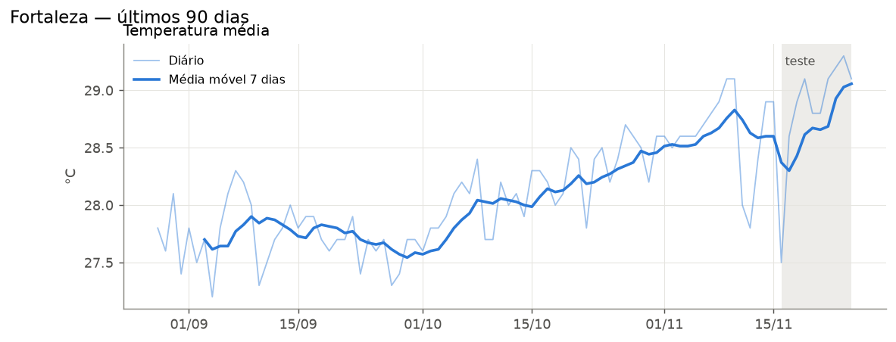
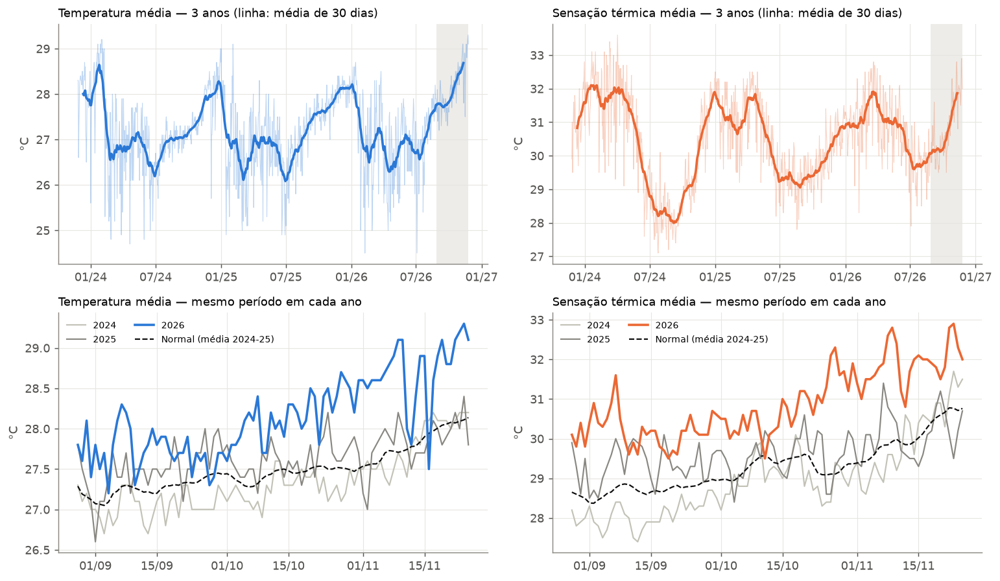
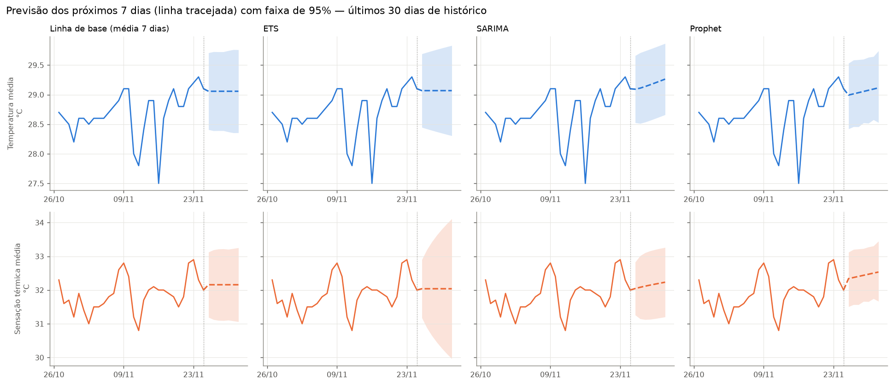

# Relatório final — previsão de temperatura em Fortaleza

> **Retrato de 26-11-2026, revisado em 27-11-2026.** Os números deste relatório usam os 90 dias
> de 28-08-2026 a 25-11-2026. A ferramenta atualiza os dados e retreina os modelos sozinha todo
> dia (D44), então a tela mostra sempre números atuais, que podem diferir dos daqui.
>
> **Versão atual da ferramenta:** uma série (temperatura média — D52), cinco modelos (linha de
> base, ETS, SARIMA, Prophet e **Chronos-2**, a IA moderna — D47), recomendação **Chronos-2**
> (seção 7) e uma tela com cinco cards (seção 2.1). As seções 10 e 11 mostram como levar estes
> modelos para soluções com IA, inclusive com muito mais dados.
>
> Os códigos entre parênteses (D07, D33...) apontam para as decisões detalhadas em
> [`decisoes.md`](decisoes.md). Este relatório se explica sozinho: não é preciso abrir outros
> arquivos para entendê-lo.

---

## Em poucas palavras

**O que fizemos.** Construímos uma ferramenta que olha os últimos 90 dias de temperatura de
Fortaleza e tenta adivinhar a próxima semana. Ela não dá só um número: dá
também uma **faixa** onde o valor real deve cair ("29,2 °C, provavelmente entre 28,1 e 29,6").
Comparamos cinco formas de prever — de uma regra simples ("repetir a média da última semana") até
uma IA moderna da Amazon — e, para saber qual funciona, escondemos os últimos 10 dias, pedimos a
previsão e conferimos com o que aconteceu de verdade.

**O que descobrimos.**
1. **Dá para prever melhor que a regra simples, mas o ganho é modesto.** Os melhores modelos
   erraram em média 0,3 °C por dia — até um terço menos que a regra simples. Fortaleza varia
   pouco, então todos erram pouco.
2. **O recomendado é o Chronos-2, a IA moderna.** Sem aprender nada com os nossos dados, ele
   empatou com o melhor modelo no teste e foi o melhor sozinho quando repetimos o teste um dia
   depois. O ponto fraco: a faixa dele é quase duas vezes mais larga, ou seja, diz menos.
3. **Os vencedores mudam de um teste para outro.** As diferenças entre os modelos são de décimos
   de grau; com só 10 dias de teste, parte disso é sorte. Antes de fixar um modelo em produção, o
   teste deve ser repetido em várias semanas.
4. **Um modelo só conhece o passado que viu.** Quando o clima mudou de patamar em outubro, os
   modelos que não viram a mudança erraram de 2 a 3 vezes mais — e com falsa confiança. Por isso
   a ferramenta atualiza os dados e refaz os modelos sozinha, todo dia.
5. **Para o tempo em si, a meteorologia ganha.** Sites como o do Google simulam a atmosfera
   inteira; nossos modelos só olham o histórico. O valor deste trabalho está no **método**, que
   serve para números do negócio (vendas, demanda), onde não existe uma "simulação da atmosfera"
   para consultar.

---

## 1. Resumo executivo

- **O que foi feito:** uma ferramenta web que baixa os últimos 90 dias de temperatura média de
  Fortaleza, roda cinco modelos de previsão, prevê os próximos 7 dias com uma faixa de incerteza e
  mostra tudo em gráficos e textos simples.
- **Quanto erra:** testados em 10 dias que não conheciam, os melhores modelos erraram em média
  **~0,3 °C** por dia — um terço menos que a regra simples "repetir a média da semana" (0,46 °C).
- **Modelo recomendado: Chronos-2** (D52). Uma rede neural da Amazon, já treinada com milhões de
  séries, que **empatou com o melhor** no teste (0,31 °C, junto com o Prophet) sem nenhum ajuste.
  Repetindo o teste um dia depois, foi o **melhor sozinho** (0,38 °C), enquanto o SARIMA ficou pior
  que a regra simples. O ponto fraco: a faixa de incerteza é **quase duas vezes mais larga**.
  Ranking completo na seção 7.
- **Principal lição:** um modelo só conhece o passado que viu. Quando o clima muda de patamar
  (como em meados de outubro de 2026), um modelo desatualizado erra de 2 a 3 vezes mais — e,
  quando a faixa é estreita, com falsa confiança. A ferramenta já se protege disso atualizando os
  dados e refazendo os modelos todo dia.

---

## 2. Objetivo

Provar, de ponta a ponta, o ciclo de uma previsão de série temporal pequena:

**dados → modelos → validação → previsão → tela**

Uma **série temporal** é uma sequência de valores medidos ao longo do tempo, em intervalos
regulares — aqui, um valor por dia. "Prever" é estimar os próximos valores a partir do
comportamento dos anteriores.

A pergunta central do estudo: **com só 90 dias de histórico, dá para prever a próxima semana melhor
do que uma regra simples?** Resposta curta: sim, com ganho moderado (seção 6).

A temperatura foi escolhida por ser **pública, gratuita e diária** — serve de campo de testes. O
objetivo não é o clima em si, e sim o **método** e a **ferramenta**, que valem para qualquer
número medido por dia (vendas, demanda, acessos).

### 2.1 Como a ferramenta funciona

A ferramenta tem duas partes que conversam pela internet (hoje, no mesmo computador):

```
Open-Meteo ──► backend (Python + Flask) ──JSON──► frontend (React) ──► pessoa no navegador
 (dados)        baixa, guarda, treina,             desenha gráficos,
                avalia e responde                   tabelas e textos
```

**Backend — o "motor" (Python).** É um programa que roda num servidor e faz todo o trabalho
pesado:
1. **Busca os dados:** pede ao Open-Meteo os 90 dias até ontem e guarda num arquivo CSV (uma
   tabela simples, que abre no Excel).
2. **Mantém os dados em dia:** no primeiro acesso de cada dia, percebe que falta o dia novo,
   baixa, grava e manda refazer os modelos. Sem internet, segue com os dados que tem e avisa.
3. **Roda os modelos:** os cinco recebem a série e devolvem previsão + faixa, sempre no mesmo
   formato — por isso trocar ou acrescentar um modelo não muda o resto do sistema.
4. **Avalia:** esconde os últimos 10 dias, prevê e mede o erro de cada modelo (seção 6); refaz o
   caso de estudo (seção 8) e a comparação com os anos anteriores (seção 3).
5. **Responde pedidos:** uma **API** (um "balcão de atendimento" para outros programas) com 7
   endereços, um por parte da tela — previsão, comparação dos modelos, teste, caso de estudo,
   anos anteriores, situação dos dados e opções. A resposta é **JSON** (texto organizado que
   qualquer linguagem lê).
6. **Guarda resultados prontos:** o primeiro pedido do dia treina o modelo (segundos); os
   seguintes voltam da memória na hora. Os cálculos pesados entram numa fila, um de cada vez,
   para o servidor não travar.

**Frontend — a "vitrine" (React, no navegador).** Não calcula nada de previsão: pede os dados
prontos ao backend e os mostra para quem não é técnico:
- **Seletores:** qual modelo ver (abre no Chronos-2) e quantos dias prever (1 a 14).
- **Cinco cards:** (1) previsão dos próximos dias com faixa e um resumo em texto; (2) comparação
  dos modelos (erro, cobertura, largura da faixa); (3) previsão × real nos 10 dias de teste;
  (4) comparação com os anos anteriores; (5) caso de estudo.
- **Textos em linguagem simples**, gerados por regras a partir dos números (nunca afirmam o que
  os números não mostram), datas em DD-MM-AAAA e ícones **i** explicando cada termo.
- **Nunca tela branca:** enquanto um card carrega, aparece um bloco com contador de segundos; se
  uma parte falha, só ela mostra o erro, com o botão "Tentar de novo".

**Qualidade:** cada parte tem testes automáticos (69 no backend, mais os do frontend), verificação
de estilo do código e um teste que garante que nenhum modelo "espia" os dias de teste.

---

## 3. Dados

**De onde vêm:** a temperatura média de cada dia em Fortaleza, baixada de graça do Open-Meteo (um
serviço público de dados do clima). Usamos sempre **os 90 dias que terminam ontem** — o dia de
hoje ainda não acabou. Todo dia a ferramenta baixa o dia novo sozinha.

**Como a série é** — três características que guiaram a escolha dos modelos:

| Característica | O que quer dizer | Consequência |
|---|---|---|
| **Varia pouco** | Fica quase sempre entre 27 e 29 °C | Os erros dos modelos são pequenos em °C — e as diferenças entre eles também |
| **Tem memória** | Hoje se parece muito com ontem | É isso que torna a previsão possível |
| **Não tem ciclo semanal** | O clima não sabe que dia da semana é | Os modelos foram configurados sem ciclo de 7 dias |



### Comparação com os anos anteriores

**A pergunta:** a temperatura subiu nos últimos meses. Isso é normal para a época ou é algo
diferente?

**Como respondemos:** comparamos os nossos 90 dias com o mesmo trecho do calendário nos dois anos
anteriores.

| Mesmo período (28/08 a 25/11) | Temperatura média |
|---|---|
| 2024 | 27,3 °C |
| 2025 | 27,6 °C |
| **2026** | **28,2 °C** |

**O que isso mostra:**
1. **Parte da subida é a estação do ano:** todo ano Fortaleza esquenta de agosto a novembro.
2. **Parte é anomalia:** 2026 está cerca de 0,7 °C acima dos anos anteriores e, a partir de
   **15-10-2026**, essa diferença subiu mais um degrau. Esse degrau é o ponto de partida do caso
   de estudo (seção 8).



*Os anos anteriores servem só para **entender** a série; os modelos usam só os últimos 90 dias
(D24). Na ferramenta, esta comparação fica no card "Comparação com os anos anteriores".*

---

## 4. A previsão

Cada modelo olha os 90 dias e diz como devem ser os próximos 7.

**Como ler o gráfico:**
- **Linha contínua:** o que aconteceu de verdade.
- **Linha tracejada:** o que o modelo prevê.
- **Área sombreada:** a **faixa de 95%** — onde o valor real deve cair em 95 de cada 100 dias.
  Quanto mais longe o dia, mais larga a faixa: o futuro distante é mais incerto.



**O que os modelos disseram para 26-11 a 02-12-2026** (último dia real: 29,1 °C):
- **Linha de base e ETS:** "vai ficar igual" (~29,1 °C todos os dias).
- **SARIMA, Prophet e Chronos-2:** "vai continuar subindo devagar" (até ~29,3 °C).

As previsões diferem em só 0,1 a 0,2 °C. Olhar a previsão não diz **qual modelo acerta mais** —
para isso é preciso testar (seção 6).

Na ferramenta, o card de previsão mostra o modelo escolhido, com destaques ("Amanhã: 29,1 °C,
entre 28,5 e 29,7") e um resumo em texto.

---

## 5. Como cada modelo foi decidido e configurado

Esta seção explica cada modelo do zero. Antes, quatro ideias que valem para todos.

### 5.1 Conceitos comuns

- **Treinar um modelo:** ajustar alguns números internos (os **parâmetros**) para que o modelo
  descreva bem o histórico. Ex.: "quanto o dia de ontem pesa na previsão de hoje".
- **Horizonte:** quantos dias à frente se prevê. Aqui, 7 dias (a ferramenta aceita de 1 a 14).
- **Faixa (intervalo) de 95%:** em vez de um número só, o modelo dá uma faixa onde o valor real
  deve cair em 95 de cada 100 previsões. Ex.: "29,1 °C, provavelmente entre 28,5 e 29,7 °C". Faixa
  estreita = modelo confiante. Quanto mais longe o dia previsto, mais larga a faixa.
- **Escolha automática da configuração:** ETS e SARIMA têm várias versões possíveis (com ou sem
  tendência etc.). Em vez de escolher à mão, a ferramenta treina todas as versões candidatas e
  fica com a de **menor AICc**, refazendo essa escolha a cada treino (D28).
  - **AICc** é uma "nota" para comparar versões de um modelo: soma o erro no histórico com uma
    **multa por complexidade** (cada parâmetro a mais custa pontos). Menor = melhor. Serve para
    não escolher um modelo que "decora" o histórico em vez de aprender o padrão. O "c" é uma
    correção para séries curtas como a nossa. Diferenças menores que 2 pontos são consideradas
    empate.
  - Ex.: versão A erra um pouco menos que a versão B, mas usa 3 parâmetros a mais. A multa pode
    fazer a B ganhar — a explicação mais simples que funciona é preferida.

### 5.2 Linha de base — a régua

- **O que é:** uma regra fixa, não um modelo estatístico: **a previsão para cada um dos próximos
  dias é a média dos últimos 7 dias.** Ex.: se a última semana teve média de 29,06 °C, a previsão
  é 29,06 °C para todos os 7 dias (uma reta horizontal).
- **Por que existe:** é a régua. Um modelo só vale a pena se errar menos que ela (D07).
- **Faixa de 95% (D29):** a regra não tem fórmula de incerteza, então a calculamos pelo próprio
  passado: aplicamos a regra em todos os dias do histórico, medimos quanto ela errou 1, 2, ... 7
  dias depois e usamos esse tamanho de erro como faixa. É honesto (mostra o quanto a própria
  regra costuma errar) e a faixa cresce com a distância.
- **Configuração:** fixa — não há nada a escolher.

### 5.3 ETS (suavização exponencial)

- **O que é:** uma média ponderada do passado em que **os dias recentes pesam mais** e o peso cai
  aos poucos para os dias antigos. É um modelo clássico dos anos 1950–60. "ETS" vem de *Error,
  Trend, Seasonality* (erro, tendência, sazonalidade) — as três peças que ele pode ter.
- **O parâmetro principal, α (alfa):** um número entre 0 e 1 que diz quanto o modelo confia no
  último dia.
  - α perto de 1: "amanhã ≈ hoje" — reage rápido, mas é nervoso.
  - α perto de 0: "amanhã ≈ média de muitos dias" — estável, mas lento para perceber mudanças.
  - Ex.: com α = 0,3, o último dia pesa 30%, o anterior 21% (30% de 70%), o seguinte 15% e assim
    por diante.
- **Candidatos testados (D30):** sem tendência; com tendência (a previsão sobe ou desce em linha
  reta); com **tendência amortecida** (sobe ou desce, mas cada vez menos, até estabilizar).
  Nenhum com sazonalidade, porque não há ciclo semanal.
- **Escolhido pelo AICc:**

| | Temperatura |
|---|---|
| Versão | sem tendência |
| α | **0,29** — média de vários dias |

- **O que isso significa:** o ETS prevê uma reta horizontal (estabilidade), parecida com a regra
  simples, mas dando mais peso aos dias recentes.
- **Ferramenta:** `ETSModel` da biblioteca statsmodels, que calcula a faixa de incerteza.

### 5.4 SARIMA

- **O que é:** o modelo clássico de séries temporais (método Box-Jenkins, anos 1970). O nome junta
  as peças que ele pode ter: **S**azonal + **AR** + **I** + **MA**. A configuração é escrita como
  SARIMA(p, d, q) — três números, explicados abaixo.
- **AR — autorregressivo (p):** a previsão usa os valores dos **p dias anteriores**. Ex.: com
  p = 1, "amanhã = uma fração de hoje + um ajuste". É a "memória" da série.
- **I — integrado (d):** quantas vezes a série é transformada em **variações diárias** antes de
  modelar. Com d = 0, o modelo olha os valores (29,1; 29,3; 29,2...). Com d = 1, olha as
  variações (+0,2; −0,1...). Usa-se d = 1 quando a série "passeia" sem voltar a um nível ou a uma
  reta.
- **MA — média móvel (q):** a previsão é corrigida pelo **erro dos q dias anteriores**. Ex.: com
  q = 1, se o modelo errou para baixo ontem, ele ajusta a previsão de hoje para cima.
- **Sazonal (S):** a repetição das peças acima em ciclos (ex.: a cada 7 dias). Entrou como
  candidata e **perdeu** — confirmou que não há ciclo semanal.
- **Tendência / drift:** uma inclinação constante somada à previsão. Com d = 0 chama-se
  **tendência linear** (a série oscila em torno de uma reta inclinada); com d = 1 chama-se
  **drift** (as variações diárias têm uma média diferente de zero, ex.: +0,03 °C por dia).
- **Como d é escolhido (D33):** por um teste estatístico, o **ADF** (Dickey-Fuller aumentado), que
  pergunta "a série volta sempre para uma reta?". Se a resposta for "sim" com segurança (p-valor
  menor que 0,05 — menos de 5% de chance de o teste estar enganado), usa-se d = 0 com tendência;
  senão, d = 1. Em seguida, o AICc escolhe p, q, a parte sazonal e a tendência entre **72
  combinações** (p e q de 0 a 2, com e sem parte sazonal, com e sem tendência — D31).
- **Escolhido (treino com os 90 dias):**

| | Temperatura |
|---|---|
| Teste ADF | p = 0,17 → inconclusivo → d = 1 |
| Configuração | **SARIMA(1, 1, 1) + drift** |
| Em palavras | variações diárias com memória de 1 dia, correção pelo erro de ontem e leve alta |
| Melhor versão *com* ciclo semanal | 3º lugar |

- **Observação importante:** no treino da validação (só 80 dias), a temperatura passou no teste
  ADF e ficou com SARIMA(1, 0, 0) + tendência linear. **Com séries curtas, a configuração
  escolhida muda com poucos dias a mais ou a menos** — por isso a ferramenta refaz a escolha a
  cada treino, em vez de fixá-la.
- **O que isso significa:** o SARIMA parte do último valor real (memória de curto prazo) e
  prolonga a alta recente (+0,03 °C por dia), com a faixa mais estreita entre os modelos com
  memória.
- **Ferramenta:** `SARIMAX` da statsmodels, com busca própria das combinações.

### 5.5 Prophet

- **O que é:** um modelo da Meta (2017) que desenha a série como uma **soma de curvas**: uma
  tendência + ciclos (anual, semanal) + feriados. Foi feito para séries **longas** de negócio
  (anos de dados diários, com sazonalidades fortes). Entrou no estudo **só como comparação**, para
  mostrar o que acontece quando a ferramenta não combina com o problema (D07).
- **Tendência por partes:** a tendência é uma linha que pode **mudar de inclinação** em alguns
  pontos (os "pontos de mudança"), que o próprio Prophet escolhe.
- **Configuração (D32):** todas as sazonalidades **desligadas** —
  90 dias não contêm um ano inteiro (a sazonalidade anual seria inventada) e não há ciclo
  semanal. Sobra só a tendência por partes. Faixa de 95%; semente aleatória fixa para que a faixa
  (calculada por simulação) saia igual a cada execução.
- **Característica decisiva:** o Prophet **não tem memória de curto prazo** — ele desenha a linha
  de tendência sem olhar o último valor. Por isso começa a previsão em 28,99 °C, abaixo do último
  real (29,1 °C). Isso o ajuda quando a tendência continua e o atrapalha quando ela para.

### 5.6 Chronos-2 — IA moderna

- **O que é:** uma **rede neural** da Amazon (2025). Rede neural é um programa com milhões de
  números internos ajustados para reconhecer padrões; o Chronos-2 tem cerca de 120 milhões. Ele é
  um **modelo fundacional**: já vem treinado pela Amazon com **milhões de séries de todo tipo**
  (vendas, energia, clima, tráfego) e aprendeu como séries costumam se comportar.
- **Diferença para os outros quatro:** ele **não é treinado com os nossos dados**. Recebe os 90
  valores como **contexto** (só os números — nem sabe que é temperatura) e projeta os próximos
  dias com o que já aprendeu. Na prática isso se chama **zero-shot**: prever uma série que o
  modelo nunca viu, sem nenhum ajuste. Não há configuração para escolher (nada de AICc).
- **Como sai a faixa de 95%:** o Chronos-2 não devolve uma média e uma faixa, e sim **quantis**.
  Um quantil é um valor de corte: o quantil de 2,5% é o valor com só 2,5% de chance de o real
  ficar abaixo dele. A previsão é o quantil de 50% (a **mediana**, o valor do meio), e a faixa vai
  do quantil de 2,5% ao de 97,5%. O modelo foi treinado para dar quantis de 1%, 5%, 10%... 95% e
  99%; os de 2,5% e 97,5% a biblioteca calcula entre os vizinhos (D47).
- **Configuração (D47):** versão **Chronos-2** (a mais nova; as menores, "Bolt", só dão faixas de
  até 80%, então não seriam comparáveis), rodando no processador comum (CPU), sem placa de vídeo.
  O modelo (456 MB) é baixado uma vez do Hugging Face (um repositório público de modelos); depois
  funciona **sem internet e sem espera**: a ferramenta carrega o modelo direto da cópia guardada
  no computador. A **versão do modelo é fixa** (um código de versão no nosso programa), para que
  uma atualização publicada pela Amazon não mude os números sem aviso (D51). Os dados **não saem
  do computador**. Licença Apache 2.0: gratuito, com
  uso comercial permitido.
- **Características:** é rápido (0,06 s por previsão, contra ~17 s do SARIMA, que testa 72
  combinações) e dá sempre o mesmo resultado para a mesma série. Sua faixa é **assimétrica**
  (mais espaço abaixo da mediana do que acima) e **larga**: ele aprendeu com séries muito mais
  agitadas que a de Fortaleza e não estreita a faixa para a nossa série calma.

---

## 6. Comparação dos modelos

**Como testamos:** escondemos os últimos 10 dias (16-11-2026 a 25-11-2026), treinamos cada modelo
com os 80 dias anteriores (o Chronos-2 recebe esses 80 dias como contexto) e comparamos a previsão
com o que de fato aconteceu. Os modelos nunca
viram esses 10 dias — inclusive a escolha da configuração (AICc, ADF) usou só os 80 dias de treino.
Um teste automático garante isso.

**As medidas:**
- **Erro médio (MAE):** a média de quanto a previsão errou, em °C, sem olhar o sinal. "Errou em
  média 0,38 °C." É a medida principal.
- **RMSE:** parecido com o MAE, mas pune mais os erros grandes. Se o RMSE é bem maior que o MAE,
  houve alguns dias com erro grande.
- **Cobertura:** em quantos dos 10 dias o valor real caiu dentro da faixa de 95%. Uma faixa
  honesta acerta perto de 95%. Com 10 dias, cada dia vale 10 pontos.
- **Viés:** o erro médio **com sinal**. Negativo = o modelo previu abaixo do real (subestimou).
- **vs regra simples:** quanto o erro médio ficou menor (−) ou maior (+) que o da linha de base.


| Modelo | Erro médio (MAE) | RMSE | Cobertura | Viés | vs regra simples |
|---|---|---|---|---|---|
| Linha de base | 0,46 °C | 0,55 | 7 de 10 dias | −0,24 | — |
| ETS | 0,43 °C | 0,53 | 9 de 10 dias | −0,20 | −6% |
| SARIMA | 0,38 °C | 0,50 | 9 de 10 dias | −0,10 | −18% |
| **Prophet** | **0,31 °C** | **0,46** | 9 de 10 dias | −0,01 | **−33%** |
| Chronos-2 | **0,31 °C** | 0,49 | 9 de 10 dias | +0,05 | −32% |

**Largura média da faixa de 95% no teste (°C)** — quanto mais estreita, mais útil, desde que
acerte:

| Linha de base | ETS | SARIMA | Prophet | Chronos-2 |
|---|---|---|---|---|
| 1,19 | 1,30 | 1,14 | 1,01 | **2,14** |

**Leitura:**
- **Todos os modelos bateram a regra simples**, mas ETS por pouco (−6%): na prática, um empate.
- **Quem prolongou a alta errou menos:** a temperatura continuou subindo durante o teste (viés
  negativo em quase todos). Prophet, Chronos-2 e SARIMA, que seguem a tendência, ganharam.
- **Um dia atípico:** 16-11-2026 teve 27,5 °C (provável dia de chuva). Todos os modelos erraram
  esse dia em +1,1 a +1,3 °C. Sem ele, o ranking da temperatura não muda.
- **Faixas honestas:** cobertura de 90% nos modelos, perto dos 95% prometidos. Só a linha de
  base ficou abaixo (70%), porque a alta continuou nos últimos dias.
- **Chronos-2, a IA moderna:** sem nenhum treino, empatou com o Prophet no menor erro (0,31 °C).
  Acerta a faixa tanto quanto os outros, mas com uma faixa **quase duas vezes mais larga** —
  acertar uma faixa larga é fácil. Por isso a cobertura deve ser lida junto com a largura.

---

## 7. Modelo vencedor

> **Recomendação: Chronos-2.** Deve errar, em média, entre 0,3 e 0,4 °C por dia na próxima
> semana.

**Como chegamos aqui:** fizemos o teste da seção 6 duas vezes, com um dia de diferença. Em cada
teste, ganha o modelo com **menor erro médio**.

| Modelo | Teste 1 (16 a 25/11) | Teste 2 (17 a 26/11) | Resumo |
|---|---|---|---|
| **Chronos-2** | 0,31 °C — 1º (empate) | 0,38 °C — **1º** | Entre os melhores nos dois testes |
| Prophet | 0,31 °C — 1º (empate) | 0,47 °C — 2º | Bom só enquanto a tendência continua |
| SARIMA | 0,38 °C — 3º | 0,68 °C — 5º | Caiu muito no segundo teste |
| ETS | 0,43 °C — 4º | 0,63 °C — 4º | Quase igual à regra simples |
| Linha de base | 0,46 °C — 5º | 0,62 °C — 3º | A régua |

**Por que o Chronos-2:**
1. **Foi o único entre os melhores nos dois testes.** Os outros subiram e desceram no ranking.
2. **Não precisa de configuração:** já vem treinado; não há nada para escolher ou ajustar.
3. **É rápido e estável:** 0,06 s por previsão, e a mesma série dá sempre a mesma resposta.

**O ponto fraco:** a faixa dele é quase **duas vezes mais larga** que a dos outros (2,1 °C contra
cerca de 1,1 °C). Ela quase sempre acerta, mas diz menos — é como dizer "amanhã vai fazer entre 28
e 30 °C".

**Dois cuidados:**
- **O teste é curto** (10 dias) e as diferenças são de décimos de grau; parte é sorte. Antes de
  usar de verdade, o teste deve ser repetido em várias semanas.
- **Para prever o tempo, a meteorologia ganha:** ela simula a atmosfera inteira. O valor deste
  estudo é o **método**, que serve para números do negócio, onde essa simulação não existe.

Na ferramenta, o card "Comparação dos modelos" mostra o mesmo teste, recalculado todo dia. Dá para
escolher qualquer modelo; a tela abre no Chronos-2.

---

## 8. Caso de estudo: o que acontece quando o padrão muda

**A situação:** em 15-10-2026 a temperatura de Fortaleza subiu de patamar (seção 3). Isso se chama
**quebra estrutural**: a série passa a se comportar de outro jeito. Em negócios acontece o tempo
todo — preço novo, concorrente novo, pandemia.

**A pergunta:** um modelo que **não viu** a mudança continua prevendo bem?

**O experimento:** treinamos cada modelo de dois jeitos e testamos os dois nos mesmos 10 dias:
- **Desatualizado:** só com os dias **antes** da mudança.
- **Atualizado:** com todos os dias.


| Modelo | Erro atualizado | Erro desatualizado | Quanto piorou |
|---|---|---|---|
| Linha de base | 0,46 °C | 0,94 °C | 2,0× |
| ETS | 0,43 °C | 0,95 °C | 2,2× |
| SARIMA | 0,38 °C | 1,11 °C | 2,9× |
| Chronos-2 | 0,31 °C | 1,04 °C | 3,4× |
| Prophet | 0,31 °C | 0,31 °C | 1,0× (não piorou) |

**O que aprendemos:**
1. **O modelo desatualizado erra 2 a 3 vezes mais — e sempre para o mesmo lado:** continua
   prevendo o patamar antigo.
2. **E erra com confiança.** O SARIMA desatualizado deu uma faixa estreita no lugar errado: o valor
   real caiu dentro dela em só 1 de 10 dias. A faixa de 95% só mede a incerteza do mundo que o
   modelo conhece.
3. **Nem a IA moderna escapa.** O Chronos-2 foi o que mais piorou: ele só conhece o que recebe.
4. **O Prophet passou ileso por sorte:** ele prolonga a tendência de subida, e a temperatura
   continuou subindo. Se a tendência virasse, ele seria o primeiro a errar.

**Conclusão prática:** o remédio não é achar o modelo perfeito, e sim **atualizar os dados e
retreinar com frequência**. A ferramenta já faz isso todo dia.

*Também testamos treinar só com os dias depois da mudança: ajudou alguns modelos e piorou outros
— com poucos dias, o modelo fica instável. Usar todos os dias foi o mais seguro. Na ferramenta,
o card "Caso de estudo" mostra esta comparação, recalculada com os dados do dia.*

---

## 9. Isto é IA?

Depende do que se chama de "IA". Vale ser preciso para não criar expectativas erradas.

**O mapa:**

| Nível | Exemplos | Aprende com os dados? | Onde este estudo está |
|---|---|---|---|
| 1. Regras fixas | "média dos últimos 7 dias" | Não | Linha de base |
| 2. Estatística clássica | ETS, SARIMA, Prophet | Sim — ajusta poucos parâmetros (2 a 6) só com os seus dados | **ETS, SARIMA, Prophet** |
| 3. Machine learning | gradient boosting, random forest | Sim — padrões mais livres, precisa de muito mais dados (seção 11) | — |
| 4. Deep learning / IA moderna | redes neurais; **modelos fundacionais** (Chronos, TimesFM) | Sim — treinados com milhões de séries (não com os seus) | **Chronos-2** |

- No sentido amplo, os níveis 2 a 4 são todos "aprendizado a partir de dados". No sentido comum
  do mercado, "IA" quer dizer os níveis 3 e 4.
- **Por que o estudo usa estatística clássica (D07):** com 90 valores, machine learning e redes
  neurais próprias não têm dados suficientes e tendem a decorar o ruído. Para séries curtas, a
  estatística clássica costuma ser igual ou melhor, e é bem mais fácil de explicar.
- **A exceção são os modelos fundacionais:** como já vêm treinados com milhões de séries, eles
  conseguem prever uma série curta sem treino próprio. Por isso o Chronos-2 entrou como 5º modelo
  (seção 5.6) — e, nesta série, empatou com o melhor modelo clássico e foi o mais estável entre
  os melhores, o que o tornou o recomendado (seção 7).

**Como descrever o projeto, de forma honesta:**

> "Ferramenta de previsão de séries temporais com modelos estatísticos que aprendem com o histórico
> (ETS, SARIMA e Prophet) e um modelo de IA moderna já treinado (Chronos-2), comparados a uma
> regra simples."

---

## 10. Como levar estes modelos para soluções com IA

Os modelos deste estudo **não conversam**: recebem números e devolvem números. Os assistentes de
IA que conversam (ChatGPT, Gemini, Claude, Gemma) são **modelos de linguagem**: ótimos com texto,
fracos com contas e previsões — podem inventar um número com toda a confiança. A combinação que
funciona é **cada um no seu papel**:

| Papel | Quem faz | Exemplo |
|---|---|---|
| Prever os números | Chronos-2 (ou o modelo que vencer a validação) | "Vendas de amanhã: 1.240, entre 1.050 e 1.400" |
| Dizer quanto confiar | A validação deste estudo (erro, faixa, comparação com a regra simples) | "Nas últimas semanas, errou em média 6%" |
| Explicar e sugerir a ação | Modelo de linguagem | "A previsão sobe por causa da tendência recente; sugiro reforçar o estoque de sexta" |

**Formas práticas de juntar as duas coisas:**
1. **Previsão como ferramenta de um assistente.** A pessoa pergunta "quanto vamos vender na semana
   que vem?". O assistente **chama a nossa API** (`/api/previsao`), recebe previsão e faixa e
   responde em português, citando os números. A API já devolve JSON, o formato que esses
   assistentes usam para chamar ferramentas (*function calling*). O modelo de linguagem nunca
   chuta o número: só lê e explica.
2. **Alertas automáticos.** A ferramenta já atualiza os dados e refaz as previsões todo dia. Um
   passo a mais: quando o valor real sair da faixa de 95% (sinal de mudança, como no caso de
   estudo) ou a previsão passar de um limite, o sistema gera um aviso em texto e o envia (e-mail,
   chat). A regra decide **quando** avisar; o modelo de linguagem escreve **o quê**.
3. **Explicações na própria tela.** Hoje os textos da tela são gerados por regras (D46): sempre
   corretos, mas fixos. Um modelo de linguagem pode escrevê-los de forma mais natural e responder
   perguntas — sempre a partir dos números da API e conferido contra eles.
4. **Pessoa no meio.** A previsão vira sugestão ("pedir 20% a mais"), mas quem aprova é uma
   pessoa — principalmente quando a faixa é larga ou houve mudança recente.

**Cuidados que este estudo já ensinou:**
- **Sempre comparar com uma regra simples.** Se a IA não erra menos que "repetir a média da
  semana", ela não vale o custo.
- **Faixa larga não é acerto.** O Chronos-2 acertou a faixa mesmo errando o nível (seção 8).
- **Atualizar com frequência.** Nenhum modelo, nem a IA moderna, percebe uma mudança que não viu.
- **Fixar a versão do modelo** (como já feito com o Chronos-2 — D51), para uma atualização do
  fornecedor não mudar os números sem aviso.
- **Privacidade:** o Chronos-2 roda no próprio computador e os dados não saem; modelos de
  linguagem na nuvem enviam os dados ao fornecedor — ler os termos antes de usar dados do cliente.

---

## 11. E com muito mais dados?

Este estudo usou **uma série com 90 valores**. Em empresas, o normal é bem maior: anos de
histórico, **centenas ou milhares de séries** (uma por produto, loja ou cliente) e informações
extras (preço, promoção, feriado, clima). *Esta seção é referência para próximos projetos: nada
daqui foi implementado.*

### 11.1 O que muda quando os dados crescem

| Tipo de "mais dados" | Exemplo | O que isso permite |
|---|---|---|
| **Histórico mais longo** | 3 anos de vendas diárias (~1.100 valores) | Ver o ciclo do ano (Natal, férias) e testar em várias semanas |
| **Muitas séries** | 2.000 produtos × 365 dias | Um modelo aprender com todas ao mesmo tempo |
| **Variáveis extras** | Preço, promoção, feriado, tempo | Explicar o *porquê* da variação, não só repetir o passado |

### 11.2 Como os 5 modelos deste estudo se sairiam

| Modelo | Com muito mais dados |
|---|---|
| **Linha de base** | Continua sendo a régua — obrigatória em qualquer tamanho. |
| **ETS e SARIMA** | Funcionam bem com histórico longo e com ciclos, mas fazem **um modelo por série** e não aproveitam o que as outras séries ensinam. O SARIMA testa 72 combinações por série (~17 s cada): 2.000 séries levariam horas. Há versões bem mais rápidas (biblioteca `statsforecast`). |
| **Prophet** | Melhora muito: com anos de dados aprende o ciclo do ano e o efeito dos feriados — foi feito para isso. |
| **Chronos-2** | Continua útil: aceita históricos longos, prevê muitas séries de uma vez e aceita variáveis extras. Pode ainda ser **ajustado** com os dados da empresa (*fine-tuning*). |

### 11.3 Técnicas que passam a ser melhores

Com muitos dados, a grande virada é o **modelo global**: em vez de um modelo por série, **um só
modelo aprende com todas**. O que ele aprende com um produto ajuda a prever outro parecido —
inclusive produtos novos, com pouco histórico.

| Técnica | O que é, em palavras simples | Quando usar |
|---|---|---|
| **Gradient boosting** (LightGBM, XGBoost) | Muitas árvores de decisão pequenas, cada uma corrigindo o erro das anteriores. Recebe uma tabela com "vendas de ontem, da semana passada, dia da semana, preço, promoção…" | Muitas séries com variáveis extras. Foi a técnica vencedora da maior competição pública de previsão de vendas (M5, com dados do Walmart). |
| **Redes neurais para séries** (DeepAR, N-HiTS, TFT) | Redes treinadas com todas as séries da empresa ao mesmo tempo | Milhares de séries longas; mais difíceis de treinar e de explicar |
| **Modelos fundacionais com ajuste** (Chronos-2; TimesFM, do Google; Moirai, da Salesforce) | O mesmo tipo do Chronos-2, com um "ajuste fino" nos dados da empresa | Quando o zero-shot já é bom e há dados para ficar ainda melhor |
| **Reconciliação hierárquica** | Faz a soma das previsões dos produtos bater com a previsão da loja e do total | Quando há níveis (produto → loja → região) |

**A forma de avaliar também muda:**
- **Testar em várias janelas** (*backtesting*): repetir o teste deste estudo em dezenas de
  semanas, não em uma.
- **Erro em porcentagem**, não na unidade: "errou 10 unidades" não compara um produto que vende
  20 por dia com outro que vende 2.000.
- **A regra simples continua sendo a régua.** O normal é descobrir em quais séries o modelo
  sofisticado vale a pena — raramente em todas.

### 11.4 Como levar para soluções com IA nessa escala

A ideia da seção 10 continua — **o modelo de previsão calcula, o assistente explica** —, mas a
arquitetura cresce:

```
Dados da empresa ──► previsão em lote (toda noite) ──► banco de previsões
(vendas, preço,       modelo global ou Chronos-2,        previsão + faixa + erro
 promoções)           com validação automática           de cada série
                                                                │
              assistente de IA ◄── ferramentas (API) ◄──────────┘
              responde, resume e alerta
```

1. **Prever em lote, não na hora:** com milhares de séries, a previsão roda toda noite e fica
   guardada num banco. O assistente consulta o resultado pronto — rápido e barato.
2. **Ferramentas que resumem:** o assistente não lê 2.000 previsões. Ele chama ferramentas como
   "quais produtos podem faltar na próxima semana?" ou "quais séries saíram da faixa ontem?", que
   devolvem só o que importa.
3. **Explicar o porquê:** com variáveis extras, o modelo informa quanto cada uma pesou (ex.: "a
   promoção explica +30%"); o assistente transforma isso em texto.
4. **Vigiar e retreinar:** um painel acompanha o erro de cada série; quando ele sobe (como no caso
   de estudo), o sistema retreina e avisa.
5. **Pessoa no meio:** as previsões viram sugestões de compra, estoque ou escala; quem aprova é uma
   pessoa, principalmente onde a faixa é larga.

**Custo:** com milhares de séries, redes neurais e modelos fundacionais com ajuste costumam pedir
placa de vídeo (GPU) e mais memória. Gradient boosting e `statsforecast` rodam bem num computador
comum.
