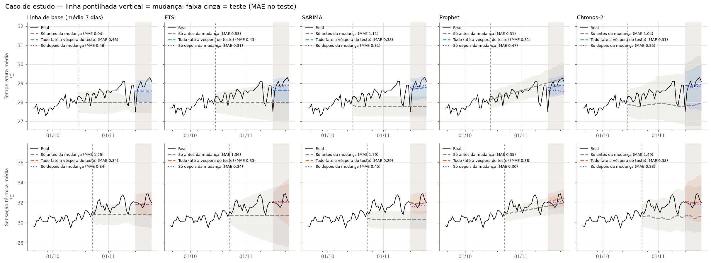

# Relatório final — POC de previsão de temperatura em Fortaleza

> **Retrato de 26-11-2026.** Os números deste relatório usam os 90 dias de 28-08-2026 a
> 25-11-2026. A ferramenta atualiza os dados e retreina os modelos sozinha todo dia (D44), então a
> tela mostra sempre números atuais, que podem diferir dos daqui.
>
> Os códigos entre parênteses (D07, D33...) apontam para as decisões detalhadas em
> [`decisoes.md`](decisoes.md). Este relatório se explica sozinho: não é preciso abrir outros
> arquivos para entendê-lo.

---

## 1. Resumo executivo

- **O que foi feito:** uma ferramenta web que baixa os últimos 90 dias de temperatura média e
  sensação térmica média de Fortaleza, treina quatro modelos de previsão, prevê os próximos 7
  dias com uma faixa de incerteza e mostra tudo em gráficos e textos simples.
- **Quanto erra:** testados em 10 dias que não conheciam, os melhores modelos erraram em média
  **0,3 a 0,4 °C** por dia — de 15% a 33% menos que a regra simples "repetir a média da semana".
- **Modelo recomendado: SARIMA.** Não foi o melhor em tudo, mas foi o **mais consistente**: 2º
  lugar na temperatura (erro de 0,38 °C) e 1º na sensação térmica (0,29 °C), sempre melhor que a
  regra simples. O Prophet ganhou na temperatura (0,31 °C), mas foi o pior na sensação.
- **Principal lição:** um modelo só conhece o passado que viu. Quando o clima muda de patamar
  (como em meados de outubro de 2026), um modelo desatualizado erra de 2 a 6 vezes mais — e com
  falsa confiança. A ferramenta já se protege disso retreinando todo dia.
- **Próximo passo recomendado:** testar o **Chronos**, um modelo de IA moderna gratuito, como 5º
  modelo (seção 11.2).

---

## 2. Objetivo

Provar, de ponta a ponta, o ciclo de uma previsão de série temporal pequena:

**dados → modelos → validação → previsão → tela**

Uma **série temporal** é uma sequência de valores medidos ao longo do tempo, em intervalos
regulares — aqui, um valor por dia. "Prever" é estimar os próximos valores a partir do
comportamento dos anteriores.

A pergunta central da POC: **com só 90 dias de histórico, dá para prever a próxima semana melhor
do que uma regra simples?** Resposta curta: sim, com ganho moderado (seção 6).

---

## 3. Dados

| Item | Valor |
|---|---|
| Local | Fortaleza-CE (lat −3,72, lon −38,54), fuso `America/Fortaleza` |
| Variáveis | Temperatura média diária e sensação térmica média diária |
| Período | 90 dias terminando **ontem** (hoje ainda está incompleto) — no retrato: 28-08-2026 a 25-11-2026 |
| Fonte | Open-Meteo, API histórica (`best_match`), gratuita e sem cadastro |
| Atualização | Automática: ao primeiro acesso do dia, a ferramenta baixa os dados novos e retreina |

**Sensação térmica** é a temperatura que o corpo "sente", combinando temperatura, umidade e vento.
Em Fortaleza ela fica ~2,7 °C acima da temperatura. As duas variáveis são previstas **de forma
independente**, cada uma só pelo seu próprio histórico.

**Como a série se comporta (90 dias):**

| °C | Temperatura | Sensação |
|---|---|---|
| Média | 28,15 | 30,87 |
| Variação típica (desvio-padrão) | 0,52 | 0,88 |
| Mínimo / máximo | 27,2 / 29,3 | 29,5 / 32,9 |

- **Fortaleza varia pouco:** a temperatura oscila tipicamente ±0,5 °C em torno da média. Por isso
  os erros dos modelos são pequenos em °C — e as diferenças entre eles também.
- **A série tem "memória":** o valor de hoje se parece muito com o de ontem (correlação de 0,75 na
  temperatura e 0,87 na sensação). É isso que torna a previsão possível.
- **Não há padrão semanal:** o clima não sabe que dia da semana é. Os modelos foram configurados
  sem ciclo de 7 dias.
- **2026 está mais quente que o normal:** comparando com o mesmo período de 2024 e 2025, 2026 está
  +0,66 °C acima na temperatura e +1,58 °C na sensação, e subiu mais um degrau em meados de
  outubro (base do caso de estudo, seção 8).

*Os dados de 3 anos foram usados só para **entender** a série (estação x anomalia), nunca para
treinar os modelos.*

---

## 4. Gráficos da previsão

Previsão dos 7 dias seguintes (26-11-2026 a 02-12-2026) pelos quatro modelos, treinados com os 90
dias. A linha contínua é o histórico real; as tracejadas são as previsões; a área sombreada é a
**faixa de 95%** (explicada na seção 5.1).

| Previsão (°C) | Temp. 26-11 | Temp. 02-12 | Sens. 26-11 | Sens. 02-12 |
|---|---|---|---|---|
| Linha de base | 29,06 | 29,06 | 32,16 | 32,16 |
| ETS | 29,07 | 29,07 | 32,04 | 32,04 |
| SARIMA | 29,09 | 29,26 | 32,04 | 32,23 |
| Prophet | 28,99 | 29,11 | 32,34 | 32,53 |

Último valor real (25-11-2026): 29,1 °C (temperatura) e 32,0 °C (sensação).

Os modelos se dividem em dois grupos: **linha de base e ETS** preveem estabilidade; **SARIMA e
Prophet** prolongam a alta recente (≈ +0,2 °C na semana).

Na ferramenta web, o mesmo gráfico aparece para o modelo escolhido, com cartões de destaque
("Amanhã: 29,1 °C, entre 28,5 e 29,7") e um resumo em texto simples gerado com os números reais.

---

## 5. Como cada modelo foi decidido e configurado

Esta seção explica cada modelo do zero. Antes, quatro ideias que valem para todos.

### 5.1 Conceitos comuns

- **Treinar um modelo:** ajustar alguns números internos (os **parâmetros**) para que o modelo
  descreva bem o histórico. Ex.: "quanto o dia de ontem pesa na previsão de hoje".
- **Horizonte:** quantos dias à frente se prevê. Aqui, 7 dias (a ferramenta aceita de 1 a 14).
- **Faixa (intervalo) de 95%:** em vez de um número só, o modelo dá uma faixa onde o valor real
  deve cair em 95 de cada 100 previsões. Ex.: "29,1 °C, provavelmente entre 28,5 e 29,7 °C". Faixa
  estreita = modelo confiante. Quanto mais longe o dia previsto, mais larga a faixa.
- **Escolha automática da configuração:** ETS e SARIMA têm várias versões possíveis (com ou sem
  tendência etc.). Em vez de escolher à mão, a ferramenta treina todas as versões candidatas e
  fica com a de **menor AICc**, refazendo essa escolha a cada treino (D28).
  - **AICc** é uma "nota" para comparar versões de um modelo: soma o erro no histórico com uma
    **multa por complexidade** (cada parâmetro a mais custa pontos). Menor = melhor. Serve para
    não escolher um modelo que "decora" o histórico em vez de aprender o padrão. O "c" é uma
    correção para séries curtas como a nossa. Diferenças menores que 2 pontos são consideradas
    empate.
  - Ex.: versão A erra um pouco menos que a versão B, mas usa 3 parâmetros a mais. A multa pode
    fazer a B ganhar — a explicação mais simples que funciona é preferida.

### 5.2 Linha de base — a régua

- **O que é:** uma regra fixa, não um modelo estatístico: **a previsão para cada um dos próximos
  dias é a média dos últimos 7 dias.** Ex.: se a última semana teve média de 29,06 °C, a previsão
  é 29,06 °C para todos os 7 dias (uma reta horizontal).
- **Por que existe:** é a régua. Um modelo só vale a pena se errar menos que ela (D07).
- **Faixa de 95% (D29):** a regra não tem fórmula de incerteza, então a calculamos pelo próprio
  passado: aplicamos a regra em todos os dias do histórico, medimos quanto ela errou 1, 2, ... 7
  dias depois e usamos esse tamanho de erro como faixa. É honesto (mostra o quanto a própria
  regra costuma errar) e a faixa cresce com a distância.
- **Configuração:** fixa — não há nada a escolher. Igual para as duas variáveis.

### 5.3 ETS (suavização exponencial)

- **O que é:** uma média ponderada do passado em que **os dias recentes pesam mais** e o peso cai
  aos poucos para os dias antigos. É um modelo clássico dos anos 1950–60. "ETS" vem de *Error,
  Trend, Seasonality* (erro, tendência, sazonalidade) — as três peças que ele pode ter.
- **O parâmetro principal, α (alfa):** um número entre 0 e 1 que diz quanto o modelo confia no
  último dia.
  - α perto de 1: "amanhã ≈ hoje" — reage rápido, mas é nervoso.
  - α perto de 0: "amanhã ≈ média de muitos dias" — estável, mas lento para perceber mudanças.
  - Ex.: com α = 0,3, o último dia pesa 30%, o anterior 21% (30% de 70%), o seguinte 15% e assim
    por diante.
- **Candidatos testados (D30):** sem tendência; com tendência (a previsão sobe ou desce em linha
  reta); com **tendência amortecida** (sobe ou desce, mas cada vez menos, até estabilizar).
  Nenhum com sazonalidade, porque não há ciclo semanal.
- **Escolhido pelo AICc:**

| | Temperatura | Sensação |
|---|---|---|
| Versão | sem tendência | sem tendência |
| α | **0,29** — média de vários dias | **0,89** — quase "amanhã = hoje" |

- **O que isso significa:** o ETS prevê uma reta horizontal (estabilidade). Na sensação, o α alto
  faz a faixa de 95% "explodir" de 1,7 °C para 4,2 °C de largura em 7 dias: como o modelo segue
  muito o último dia, ele admite que pode errar bastante mais à frente.
- **Ferramenta:** `ETSModel` da biblioteca statsmodels, que calcula a faixa de incerteza.

### 5.4 SARIMA

- **O que é:** o modelo clássico de séries temporais (método Box-Jenkins, anos 1970). O nome junta
  as peças que ele pode ter: **S**azonal + **AR** + **I** + **MA**. A configuração é escrita como
  SARIMA(p, d, q) — três números, explicados abaixo.
- **AR — autorregressivo (p):** a previsão usa os valores dos **p dias anteriores**. Ex.: com
  p = 1, "amanhã = uma fração de hoje + um ajuste". É a "memória" da série.
- **I — integrado (d):** quantas vezes a série é transformada em **variações diárias** antes de
  modelar. Com d = 0, o modelo olha os valores (29,1; 29,3; 29,2...). Com d = 1, olha as
  variações (+0,2; −0,1...). Usa-se d = 1 quando a série "passeia" sem voltar a um nível ou a uma
  reta.
- **MA — média móvel (q):** a previsão é corrigida pelo **erro dos q dias anteriores**. Ex.: com
  q = 1, se o modelo errou para baixo ontem, ele ajusta a previsão de hoje para cima.
- **Sazonal (S):** a repetição das peças acima em ciclos (ex.: a cada 7 dias). Entrou como
  candidata e **perdeu** — confirmou que não há ciclo semanal.
- **Tendência / drift:** uma inclinação constante somada à previsão. Com d = 0 chama-se
  **tendência linear** (a série oscila em torno de uma reta inclinada); com d = 1 chama-se
  **drift** (as variações diárias têm uma média diferente de zero, ex.: +0,03 °C por dia).
- **Como d é escolhido (D33):** por um teste estatístico, o **ADF** (Dickey-Fuller aumentado), que
  pergunta "a série volta sempre para uma reta?". Se a resposta for "sim" com segurança (p-valor
  menor que 0,05 — menos de 5% de chance de o teste estar enganado), usa-se d = 0 com tendência;
  senão, d = 1. Em seguida, o AICc escolhe p, q, a parte sazonal e a tendência entre **72
  combinações** (p e q de 0 a 2, com e sem parte sazonal, com e sem tendência — D31).
- **Escolhido (treino com os 90 dias):**

| | Temperatura | Sensação |
|---|---|---|
| Teste ADF | p = 0,17 → inconclusivo → d = 1 | p = 0,002 → volta para uma reta → d = 0 |
| Configuração | **SARIMA(1, 1, 1) + drift** | **SARIMA(1, 0, 0) + tendência linear** |
| Em palavras | variações diárias com memória de 1 dia, correção pelo erro de ontem e leve alta | valor de hoje puxa o de amanhã, em torno de uma reta levemente inclinada |
| Melhor versão *com* ciclo semanal | 3º lugar | 5º lugar |

- **Observação importante:** no treino da validação (só 80 dias), a temperatura passou no teste
  ADF e ficou com SARIMA(1, 0, 0) + tendência linear. **Com séries curtas, a configuração
  escolhida muda com poucos dias a mais ou a menos** — por isso a ferramenta refaz a escolha a
  cada treino, em vez de fixá-la.
- **O que isso significa:** o SARIMA parte do último valor real (memória de curto prazo) e
  prolonga a alta recente (+0,03 °C por dia), com a faixa mais estreita entre os modelos com
  memória.
- **Ferramenta:** `SARIMAX` da statsmodels, com busca própria das combinações.

### 5.5 Prophet

- **O que é:** um modelo da Meta (2017) que desenha a série como uma **soma de curvas**: uma
  tendência + ciclos (anual, semanal) + feriados. Foi feito para séries **longas** de negócio
  (anos de dados diários, com sazonalidades fortes). Entrou na POC **só como comparação**, para
  mostrar o que acontece quando a ferramenta não combina com o problema (D07).
- **Tendência por partes:** a tendência é uma linha que pode **mudar de inclinação** em alguns
  pontos (os "pontos de mudança"), que o próprio Prophet escolhe.
- **Configuração (D32), igual para as duas variáveis:** todas as sazonalidades **desligadas** —
  90 dias não contêm um ano inteiro (a sazonalidade anual seria inventada) e não há ciclo
  semanal. Sobra só a tendência por partes. Faixa de 95%; semente aleatória fixa para que a faixa
  (calculada por simulação) saia igual a cada execução.
- **Característica decisiva:** o Prophet **não tem memória de curto prazo** — ele desenha a linha
  de tendência sem olhar o último valor. Por isso começa a previsão em 28,99 °C (abaixo do último
  real, 29,1) na temperatura, e em 32,34 °C (acima do último real, 32,0) na sensação. Isso o ajuda
  quando a tendência continua e o atrapalha quando ela para.

---

## 6. Comparação dos modelos

**Como testamos:** escondemos os últimos 10 dias (16-11-2026 a 25-11-2026), treinamos cada modelo
com os 80 dias anteriores e comparamos a previsão com o que de fato aconteceu. Os modelos nunca
viram esses 10 dias — inclusive a escolha da configuração (AICc, ADF) usou só os 80 dias de treino.
Um teste automático garante isso.

**As medidas:**
- **Erro médio (MAE):** a média de quanto a previsão errou, em °C, sem olhar o sinal. "Errou em
  média 0,38 °C." É a medida principal.
- **RMSE:** parecido com o MAE, mas pune mais os erros grandes. Se o RMSE é bem maior que o MAE,
  houve alguns dias com erro grande.
- **Cobertura:** em quantos dos 10 dias o valor real caiu dentro da faixa de 95%. Uma faixa
  honesta acerta perto de 95%. Com 10 dias, cada dia vale 10 pontos.
- **Viés:** o erro médio **com sinal**. Negativo = o modelo previu abaixo do real (subestimou).
- **vs regra simples:** quanto o erro médio ficou menor (−) ou maior (+) que o da linha de base.

**Temperatura média**

| Modelo | Erro médio (MAE) | RMSE | Cobertura | Viés | vs regra simples |
|---|---|---|---|---|---|
| Linha de base | 0,46 °C | 0,55 | 7 de 10 dias | −0,24 | — |
| ETS | 0,43 °C | 0,53 | 9 de 10 dias | −0,20 | −6% |
| SARIMA | 0,38 °C | 0,50 | 9 de 10 dias | −0,10 | −18% |
| **Prophet** | **0,31 °C** | **0,46** | 9 de 10 dias | −0,01 | **−33%** |

**Sensação térmica média**

| Modelo | Erro médio (MAE) | RMSE | Cobertura | Viés | vs regra simples |
|---|---|---|---|---|---|
| Linha de base | 0,34 °C | 0,49 | 10 de 10 dias | −0,24 | — |
| ETS | 0,33 °C | 0,42 | 10 de 10 dias | −0,03 | −2% |
| **SARIMA** | **0,29 °C** | 0,44 | 10 de 10 dias | −0,16 | **−15%** |
| Prophet | 0,38 °C | 0,43 | 10 de 10 dias | +0,19 | +13% (pior) |

**Leitura:**
- **Quase todos os modelos bateram a regra simples** — a exceção foi o Prophet na sensação.
  Entre ETS e linha de base a diferença (0,01–0,03 °C) é um empate prático.
- **Na temperatura, quem prolongou a alta errou menos:** a temperatura continuou subindo durante
  o teste (viés negativo em todos). Prophet e SARIMA, que seguem a tendência, ganharam.
- **Na sensação, o Prophet exagerou:** previu subida, e a sensação ficou estável nos últimos dias
  (viés +0,19). Sem memória de curto prazo, ele não percebeu que a alta tinha parado.
- **Um dia atípico:** 16-11-2026 teve 27,5 °C (provável dia de chuva). Todos os modelos erraram
  esse dia em +1,1 a +1,3 °C. Sem ele, o ranking da temperatura não muda.
- **Faixas honestas:** cobertura de 90–100% nos modelos, perto dos 95% prometidos. Só a linha de
  base na temperatura ficou abaixo (70%), porque a alta continuou nos últimos dias.

---

## 7. Modelo vencedor

**Recomendação: SARIMA**, com erro médio esperado de **~0,3 a 0,4 °C** por dia na próxima
semana.

| Critério | SARIMA | Prophet |
|---|---|---|
| Temperatura | 2º (0,38 °C, −18%) | **1º** (0,31 °C, −33%) |
| Sensação | **1º** (0,29 °C, −15%) | 4º (0,38 °C, +13%) |
| Sempre melhor que a regra simples? | **Sim** | Não |
| Parte do último valor real? | Sim (memória de curto prazo) | Não |

**Por quê:** o Prophet tem o melhor número isolado, mas depende de a tendência continuar — e
falhou quando ela parou (sensação). O SARIMA ficou bem colocado nas duas variáveis, sempre melhor
que a régua, e reage ao último dia observado. Para uma ferramenta que vai prever séries novas
todos os dias, **consistência vale mais que o melhor resultado em um teste**.

**Cuidados com esta conclusão:**
- É um teste de **10 dias**, numa fase de **subida sazonal** (agosto → novembro). Em dezembro,
  quando a temperatura estabiliza no pico do ciclo anual, modelos que prolongam a tendência podem
  passar do ponto.
- As diferenças entre modelos são de décimos de grau. Com mais tempo de uso, o ideal é repetir a
  comparação em várias semanas antes de fixar um vencedor.
- Na ferramenta, o usuário pode escolher qualquer um dos quatro modelos e ver o erro de cada um.

---

## 8. Caso de estudo: mudança brusca no clima (quebra estrutural)

**Quebra estrutural** é quando a série muda de patamar e passa a se comportar de outro jeito.
Em 2026, a anomalia (diferença em relação ao normal dos anos anteriores) subiu um degrau em
**15-10-2026** na temperatura (+0,49 → +0,86 °C) e em **23-10-2026** na sensação
(+1,35 → +1,96 °C). As datas foram encontradas automaticamente: o método testa cada data de corte
e escolhe a que melhor divide a série em dois trechos com médias diferentes (D26).

**A pergunta:** o que acontece com um modelo que não viu essa mudança?

**O experimento (D35):** cada modelo foi treinado de três jeitos e todos foram avaliados nos
mesmos 10 dias de teste (16-11-2026 a 25-11-2026):
- **Só antes:** treinado só com os dias anteriores à mudança (modelo "desatualizado");
- **Tudo:** treinado com todos os 80 dias de treino (o normal);
- **Só depois:** treinado só com os dias depois da mudança.

**Erro médio no teste (°C) e cobertura da faixa**

| Modelo | Temp. só antes | Temp. tudo | Temp. só depois | Sens. só antes | Sens. tudo | Sens. só depois |
|---|---|---|---|---|---|---|
| Linha de base | 0,94 (1/10) | 0,46 (7/10) | 0,46 (9/10) | 1,29 (5/10) | 0,34 (10/10) | 0,34 (9/10) |
| ETS | 0,95 (5/10) | 0,43 (9/10) | 0,31 (9/10) | 1,36 (10/10) | 0,33 (10/10) | 0,34 (10/10) |
| SARIMA | **1,11 (1/10)** | 0,38 (9/10) | 0,31 (9/10) | **1,79 (0/10)** | 0,29 (10/10) | 0,45 (8/10) |
| Prophet | 0,31 (9/10) | 0,31 (9/10) | 0,47 (6/10) | 0,35 (9/10) | 0,38 (10/10) | 0,30 (10/10) |

**O que aprendemos:**
1. **O modelo desatualizado erra muito e sempre para o mesmo lado.** Linha de base, ETS e SARIMA
   "só antes" erraram de **2 a 6 vezes mais** que com "tudo", sempre para baixo: continuaram
   prevendo o patamar antigo.
2. **A faixa de 95% não protege contra mudanças.** O SARIMA "só antes" acertou a faixa em 1 e
   0 de 10 dias: a faixa era estreita e confiante — no regime errado. Uma faixa só mede a
   incerteza do mundo que o modelo conhece.
3. **O Prophet sobreviveu, mas por sorte de calendário.** Mesmo treinado "só antes", ele aprendeu
   a subida de setembro/outubro e a prolongou — e a série continuou subindo. Um modelo de
   **tendência** sobrevive a uma mudança que continua a tendência; em dezembro, essa reta passaria
   do ponto.
4. **Descartar o passado ajuda às vezes, mas é arriscado.** "Só depois" melhorou ETS e SARIMA na
   temperatura, mas piorou o SARIMA na sensação (só 24 dias de treino = parâmetros instáveis).
   "Tudo" foi a escolha mais segura.

**Conclusão prática:** o remédio contra quebras é **retreinar com frequência**, não procurar o
modelo "perfeito". **A ferramenta já faz isso:** todo dia os dados são atualizados e os modelos
retreinados (D44).

*Observação: o caso de estudo é recalculado com os dados atuais. Quando a mudança de outubro sair
da janela de 90 dias, o detector ainda apontará alguma data, mesmo sem uma mudança forte — os
números da tela vão mudar em relação a este relatório.*

---

## 9. Isto é IA?

Depende do que se chama de "IA". Vale ser preciso para não criar expectativas erradas.

**O mapa:**

| Nível | Exemplos | Aprende com os dados? | Onde a POC está |
|---|---|---|---|
| 1. Regras fixas | "média dos últimos 7 dias" | Não | Linha de base |
| 2. Estatística clássica | ETS, SARIMA, Prophet | Sim — ajusta poucos parâmetros (2 a 6) só com os seus dados | **ETS, SARIMA, Prophet** |
| 3. Machine learning | gradient boosting, random forest | Sim — padrões mais livres, precisa de muito mais dados | — |
| 4. Deep learning / IA moderna | redes neurais; **modelos fundacionais** (Chronos, TimesFM) | Sim — treinados com milhões de séries | **Chronos = próximo passo** |

- No sentido amplo, os níveis 2 a 4 são todos "aprendizado a partir de dados". No sentido comum
  do mercado, "IA" quer dizer os níveis 3 e 4.
- **Por que a POC usa estatística clássica (D07):** com 90 valores, machine learning e redes
  neurais próprias não têm dados suficientes e tendem a decorar o ruído. Para séries curtas, a
  estatística clássica costuma ser igual ou melhor, e é bem mais fácil de explicar.
- **A exceção são os modelos fundacionais:** como já vêm treinados com milhões de séries, eles
  conseguem prever uma série curta sem treino próprio. Por isso o Chronos é o próximo passo
  natural (seção 11.2).

**Como descrever o projeto, de forma honesta:**

> "POC de previsão de séries temporais com modelos estatísticos que aprendem com o histórico
> (ETS, SARIMA e Prophet), comparados a uma regra simples."

---

## 10. Limites da POC

- **Não enxerga umidade nem vento.** Eles influenciam a sensação térmica, mas para usá-los na
  previsão seria preciso saber a umidade e o vento *futuros* — que também teriam de ser previstos
  (D19). Temperatura e sensação são previstas de forma independente.
- **Não conhece o ciclo anual.** Fortaleza tem um ciclo de ~2 °C ao longo do ano, e 90 dias não
  mostram um ano inteiro. A alta de novembro de 2026 é em parte estação, que se estabiliza em
  dezembro — algo que os modelos não sabem (D23, D24).
- **A faixa de 95% não protege contra mudanças bruscas.** Um modelo desatualizado fica confiante no
  regime errado (seção 8). A atualização diária reduz esse risco, mas não o elimina no primeiro
  dia de uma mudança.
- **Teste curto.** A comparação usou 10 dias de uma única época do ano. Diferenças de décimos de
  grau entre modelos podem ser sorte.
- **Para prever o tempo em si, a previsão meteorológica é melhor.** Os serviços de meteorologia
  simulam a atmosfera inteira e nenhum modelo treinado só com o histórico de uma cidade os supera.
  O valor desta POC está no **método**, que serve para métricas onde não existe esse "modelo
  físico" (seção 11).
- **Números mudam com o tempo.** Este relatório é um retrato de 26-11-2026; a ferramenta mostra
  sempre os números atuais.
- **Roda localmente.** A ferramenta ainda não está publicada na internet.

---

## 11. Próximos passos

### 11.1 Já implementado: retreinar todo dia
O principal remédio contra quebras estruturais (seção 8) já está na ferramenta: a cada dia, os
dados são atualizados até ontem e os modelos retreinados, sem ação manual (D44).

### 11.2 Próximo ponto de evolução: Chronos (IA moderna)
O **Chronos** (Amazon) é um **modelo fundacional** de séries temporais: uma rede neural treinada
pela Amazon com milhões de séries de todo tipo (vendas, energia, clima, tráfego), que aprendeu
padrões gerais de como séries se comportam.

- **Como funciona:** você instala a biblioteca, ela baixa o modelo uma vez (do repositório público
  Hugging Face) e, a partir daí, funciona sem internet. Você entrega os 90 valores como
  "contexto" e ele devolve a previsão e a faixa de incerteza — sem treino próprio.
- **Dados:** não busca nem envia nada; recebe só a sequência de números (nem sabe que é
  temperatura). Os dados não saem do computador.
- **Custo:** gratuito (licença Apache 2.0, que permite uso comercial — confirmar antes de usar em
  produto). O custo é técnico: uma biblioteca grande (PyTorch, centenas de MB) e mais memória.
- **Encaixe na POC:** entra como 5º modelo pela interface comum (D27) e aparece sozinho na
  validação, no caso de estudo, na API e na tela. Responde com números à pergunta "IA moderna
  ganha da estatística clássica nesta série?".

### 11.3 Explicações em texto por IA
Hoje os textos da tela são gerados por **regras** (D46): sempre corretos, mas fixos. Uma melhoria é
um **modelo de linguagem** escrever a explicação de forma mais natural e responder perguntas ("por
que o SARIMA ganhou?"):
- **Gemma via Ollama:** gratuito, roda no computador, os dados não saem.
- **Gemini, camada gratuita:** mais capaz, mas com limites de uso e dados enviados ao Google (ler
  os termos antes de usar com dados do cliente).

Cuidados: o texto pode inventar ou exagerar (conferir contra os números), leva segundos por texto
e envolve privacidade. O modelo de linguagem **explica** a previsão; ele **não** deve fazê-la —
para números, a ferramenta certa é o Chronos.

### 11.4 Outras métricas além do clima
É onde a previsão por séries temporais mais agrega valor. Exemplo genérico: **vendas diárias de
uma loja**, para planejar estoque e equipe na próxima semana.

O que já serve para qualquer métrica: os 4 modelos, a validação, o caso de estudo, a API, a tela,
a atualização automática e os testes. O que precisaria ser generalizado:

| Ponto | Hoje | Para qualquer métrica |
|---|---|---|
| Fonte de dados | Open-Meteo fixo | Envio de CSV, banco de dados ou API do cliente, num formato padrão (data, valor, nome da série) |
| Configuração | Duas variáveis fixas no código | Cadastro por métrica: nome, unidade (°C, R$, unidades), frequência, horizonte |
| Ciclo semanal | Desligado (o clima não tem) | Ligado conforme a métrica — vendas quase sempre têm. A busca do ETS e do SARIMA já testa ciclos de 7 dias |
| Feriados e datas especiais | Não usados | Importantes em negócio (Black Friday, Natal) — ponto forte do Prophet |
| Regras do negócio | Nenhuma | Ex.: vendas nunca negativas; muitos dias com zero |
| Caso de estudo | Compara com os anos anteriores (clima) | Detectar mudanças na própria série |
| Tela | "°C" fixo | Unidade vinda do cadastro da métrica |

### 11.5 Publicar online
- **Frontend:** arquivos estáticos gerados pelo build, hospedados de graça (Netlify, Vercel).
- **Backend:** servidor na nuvem com servidor de produção (gunicorn), ~2 GB de RAM (Prophet; mais
  com o Chronos), disco persistente para os dados que a atualização grava, endereço público
  liberado no CORS, HTTPS e "aquecimento" dos modelos ao iniciar, para o primeiro visitante não
  esperar ~1 minuto.

### 11.6 Com mais histórico (2 anos ou mais)
Usar o "normal" dos anos anteriores (climatologia) como régua, ligar a sazonalidade anual no
Prophet e validar em várias janelas de 7 dias, em vez de uma só (D23).
